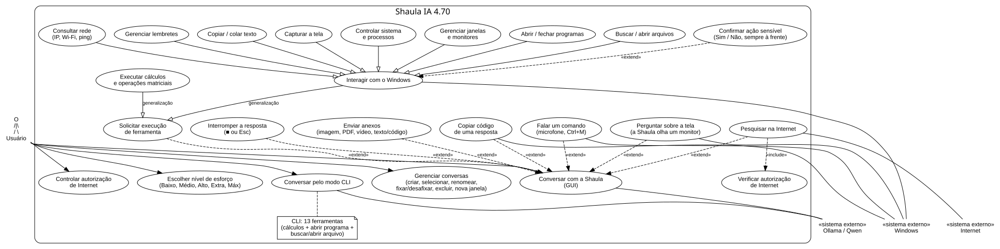

# Diagrama de Casos de Uso — Shaula IA 4.70

Este documento complementa, de forma separada, o README e o UML estrutural da Shaula IA 4.70. O objetivo aqui é representar **o que o usuário consegue fazer com o sistema** e quais sistemas externos participam dessas operações.

O diagrama foi montado com base no código da versão 4.70. As 40 ferramentas concretas não são mostradas como 40 elipses individuais, porque isso transformaria o diagrama de casos de uso em um mapa de classes/funções. Elas aparecem agrupadas pelos objetivos percebidos pelo usuário.

## Atores

- **Usuário** — ator principal; conversa com a Shaula (digitando ou falando), gerencia conversas e solicita ações.
- **Ollama / Qwen** — sistema externo local responsável pelo processamento da linguagem, raciocínio e tool-calling.
- **Internet** — sistema externo consultado pelas pesquisas, com DuckDuckGo e Bing como mecanismos implementados. A Shaula só pesquisa quando sua autorização interna de Internet está ativa.
- **Windows** — sistema operacional externo usado pelas ferramentas de arquivos, programas, janelas, processos, captura de tela, clipboard, rede, lembretes/notificações, ações de sistema e pelo **microfone** (comando por voz).

## Diagrama principal

## Casos de uso principais

| Caso de uso | Escopo na versão 4.70 |
|---|---|
| Conversar com a Shaula | Enviar mensagens pela GUI e receber respostas do modelo local, com o raciocínio e o contexto definidos pelo nível de esforço (Médio por padrão). O que não cabe no contexto do modelo chega resumido, então a conversa antiga não some por completo. |
| Falar um comando (voz) | Gravar pelo microfone (botão ou `Ctrl+M`) até o usuário parar; o áudio é transcrito localmente (Whisper, CPU) e o texto segue o mesmo caminho de uma mensagem digitada. |
| Interromper a resposta | Parar a resposta em andamento com o botão ■ ou `Esc`; uma ferramenta já executada não é desfeita. |
| Copiar código de uma resposta | Quando a resposta contém código, ele aparece num bloco com cabeçalho e botão **Copiar**; o clique leva o código inteiro para a área de transferência do Windows. |
| Perguntar sobre a tela | A ferramenta `analisar_tela` captura um monitor (o principal, ou o escolhido), esconde a janela da Shaula só durante a captura e entrega a imagem ao modelo, que responde sobre o que está visível. Nada é salvo em disco, e a imagem só vai para o Ollama local. |
| Confirmar ação sensível | Antes de desligar o computador, finalizar processo, fechar programa ou janela, ou executar um programa/script, a Shaula pergunta (Sim/Não) numa caixa que vem para a frente da tela; a resposta padrão é Não. O pedido direto de desligar o computador sempre chega à caixa, mesmo que o modelo não chame a ferramenta. Estende **Interagir com o Windows**. |
| Conversar pelo modo CLI | Usar `main.py` (classe `AssistenteTerminal`), com subconjunto de 13 ferramentas. |
| Gerenciar conversas | Criar, selecionar, renomear, fixar/desafixar, excluir e abrir conversa em nova janela. |
| Enviar anexos | Imagens, PDFs, vídeos por amostragem e arquivos de texto/código. A mensagem com anexo é respondida sem ferramentas e sem pesquisa automática, para caber no contexto do modelo. |
| Ativar/desativar Internet | Controlar o `EstadoInternet` compartilhado pela aplicação. |
| Escolher nível de esforço | Escolher entre Baixo, Médio, Alto, Extra e Máx no botão **Esforço** da barra superior: define se o modelo raciocina, o tamanho do contexto, o limite de resposta e o máximo de rodadas de ferramentas. A escolha vale para todas as janelas e é lembrada entre sessões. |
| Pesquisar na Internet | Pesquisa solicitada pelo modelo ou pesquisa automática quando a heurística factual dispara (não dispara para perguntas sobre a Shaula, sobre o computador, contas ou mensagens com anexo). |
| Executar cálculos | Calculadora (com limites contra resultados gigantes), conversão de base e operações matriciais. |
| Buscar/abrir arquivos | Localização de arquivos e abertura pelo Windows. |
| Abrir/fechar programas | Inicialização e encerramento de programas. |
| Gerenciar janelas e monitores | Listagem, movimentação e controle de janelas/monitores; várias janelas parecidas podem ser escolhidas pelo número ("chrome 2"). |
| Controlar/consultar sistema e processos | Hardware, processos (com lista de protegidos), bloqueio de tela, desligamento/cancelamento e menu Iniciar. |
| Capturar a tela | Geração de captura de tela (PNG) pelo subsistema Windows, em arquivo ou na área de transferência. |
| Copiar/colar texto | Uso da área de transferência do Windows. |
| Gerenciar lembretes | Criar, listar e cancelar lembretes (até 1 ano), com notificação local. Os lembretes ficam gravados em disco: sobrevivem ao fechamento da Shaula, e os que vencerem com ela fechada são avisados (como atrasados) ao abrir. |
| Consultar rede | IP local, Wi-Fi e teste de ping. |

## Relações importantes

- **Enviar anexos**, **Falar um comando (voz)**, **Interromper a resposta**, **Copiar código de uma resposta** e **Perguntar sobre a tela** são extensões opcionais do caso **Conversar com a Shaula**.
- **Confirmar ação sensível** estende **Interagir com o Windows**: só acontece quando a ação é uma das listadas. O reconhecimento do pedido direto de desligar (`DetectorDesligar`) é um detalhe interno desse caso de uso: garante que a pergunta aconteça, não substitui a decisão do usuário.
- **Perguntar sobre a tela** usa o **Windows** (captura e minimização temporária da janela da Shaula) e exige um modelo com visão.
- **Copiar código de uma resposta** usa a área de transferência, acessada pelo **Windows**.
- **Falar um comando (voz)** usa o microfone, acessado pelo **Windows**.
- **Pesquisar na Internet** também pode estender a conversa e inclui a verificação da autorização interna de Internet.
- **Solicitar execução de ferramenta** representa o tool-calling opcional durante uma conversa.
- **Executar cálculos** e **Interagir com o Windows** especializam esse uso de ferramentas.
- Arquivos, programas, janelas/monitores, sistema/processos, captura, clipboard, lembretes e rede especializam **Interagir com o Windows**.
- **Ollama/Qwen** participa das conversas da GUI e do CLI; **Internet** participa das pesquisas externas; **Windows** participa das ações locais dependentes do sistema operacional e do microfone.

## Correspondência com as 40 ferramentas

Os casos de uso de alto nível acima cobrem as ferramentas concretas da GUI da seguinte forma:

- **Cálculos:** 10 ferramentas.
- **Arquivos/programas:** `abrir_programa`, `fechar_programa`, `buscar_arquivo`, `abrir_arquivo`.
- **Sistema:** `desligar_computador`, `cancelar_desligamento`, `bloquear_tela`, `informacoes_hardware`, `abrir_menu_iniciar`.
- **Internet/rede:** `ativar_internet`, `desativar_internet`, `pesquisar_internet`, `testar_ping`, `obter_ip_local`, `verificar_wifi`.
- **Janelas/monitores:** `listar_monitores`, `listar_janelas_abertas`, `mover_programa_monitor`, `mover_para_outro_monitor`, `controlar_janela`.
- **Captura:** `tirar_print` e `analisar_tela`.
- **Lembretes:** `criar_lembrete`, `listar_lembretes`, `cancelar_lembrete`.
- **Processos:** `listar_processos`, `listar_processos_protegidos`, `finalizar_processo`.
- **Clipboard:** `copiar_texto`, `colar_texto`.

Os casos **Falar um comando (voz)**, **Interromper a resposta**, **Copiar código de uma resposta**, **Confirmar ação sensível**, **Escolher nível de esforço**, **Enviar anexos**, **Gerenciar conversas** e **Ativar/desativar Internet** (este, na GUI, também por ferramenta) são recursos da interface e não correspondem a ferramentas do modelo.

## Arquivos deste diagrama

- `Shaula_Casos_de_Uso_4.70.md` — documentação do diagrama.
- `Shaula_Casos_de_Uso_4.70.dot` — fonte Graphviz editável (renderize com `dot -Tsvg`).
- `Shaula_Casos_de_Uso_4.70.svg` — versão vetorial renderizada.
- `Shaula_Casos_de_Uso_4.70.png` — versão em imagem.

> Observação: o diagrama representa casos de uso, portanto agrupa detalhes internos. Classes como `RegistroFerramentas`, `GerenciadorAnexos`, `GerenciadorConversas`, `OrcamentoContexto`, estratégias e serviços pertencem ao UML estrutural e não são atores do diagrama de casos de uso.
