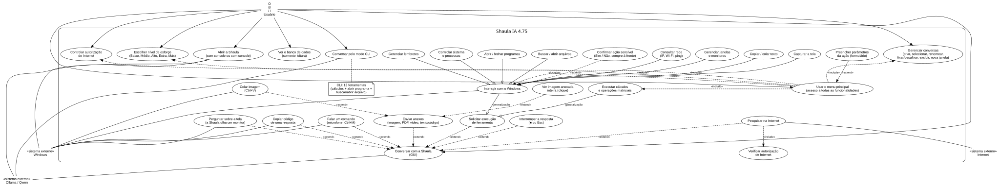

# Diagrama de Casos de Uso — Shaula IA 4.75

Este documento complementa, de forma separada, o README e o UML estrutural da Shaula IA 4.75. O objetivo aqui é representar **o que o usuário consegue fazer com o sistema** e quais sistemas externos participam dessas operações.

O diagrama foi montado com base no código da versão 4.75. As 40 ferramentas concretas não são mostradas como 40 elipses individuais, porque isso transformaria o diagrama de casos de uso em um mapa de classes/funções. Elas aparecem agrupadas pelos objetivos percebidos pelo usuário.

## Atores

- **Usuário** — ator principal; conversa com a Shaula (digitando ou falando), gerencia conversas e solicita ações.
- **Ollama / Qwen** — sistema externo local responsável pelo processamento da linguagem, raciocínio e tool-calling. É iniciado em segundo plano pelo `Shaula.bat` quando não está rodando.
- **Internet** — sistema externo consultado pelas pesquisas, com DuckDuckGo e Bing como mecanismos implementados. A Shaula só pesquisa quando sua autorização interna de Internet está ativa.
- **Windows** — sistema operacional externo usado pelas ferramentas de arquivos, programas, janelas, processos, captura de tela, clipboard, rede, lembretes/notificações, ações de sistema e pelo **microfone** (comando por voz).

## Diagrama principal

## Casos de uso principais

| Caso de uso | Escopo na versão 4.75 |
|---|---|
| Conversar com a Shaula | Enviar mensagens pela GUI e receber respostas do modelo local, com o raciocínio e o contexto definidos pelo nível de esforço (Médio por padrão). O que não cabe no contexto do modelo chega resumido, então a conversa antiga não some por completo. Se o modelo afirmar que fez uma ação sem ter chamado a ferramenta, a resposta é refeita ou sai com um aviso. |
| Falar um comando (voz) | Gravar pelo microfone (botão ou `Ctrl+M`) até o usuário parar; o áudio é transcrito localmente (Whisper, CPU) e o texto segue o mesmo caminho de uma mensagem digitada. Sem o pacote `onnxruntime` no Python usado, a voz funciona sem o filtro de silêncio. |
| Interromper a resposta | Parar a resposta em andamento com o botão ■ ou `Esc`; uma ferramenta já executada não é desfeita. |
| Copiar código de uma resposta | Quando a resposta contém código, ele aparece num bloco com cabeçalho e botão **Copiar**; o clique leva o código inteiro para a área de transferência do Windows. |
| Perguntar sobre a tela | A ferramenta `analisar_tela` captura um monitor (o principal, ou o escolhido), esconde a janela da Shaula só durante a captura e entrega a imagem ao modelo, que responde sobre o que está visível. Nada é salvo em disco, e a imagem só vai para o Ollama local. |
| Confirmar ação sensível | Antes de desligar o computador, finalizar processo, fechar programa ou janela, ou executar um programa/script, a Shaula pergunta (Sim/Não) numa caixa que vem para a frente da tela; a resposta padrão é Não. O pedido direto de desligar o computador sempre chega à caixa, mesmo que o modelo não chame a ferramenta. Estende **Interagir com o Windows**. |
| Usar o menu principal | Barra de menus da janela (Arquivo, Conversas, Programas e arquivos, Calculadora, Lembretes, Janelas e telas, Sistema, Rede e internet, Configurações e Ajuda) com acesso a todas as funcionalidades: as 40 ferramentas, a gestão de conversas, os anexos, o nível de esforço, a chave de Internet e a voz. As ferramentas são executadas direto, sem o modelo, e as confirmações de ações sensíveis continuam valendo. Só a pesquisa na Internet e a análise de tela dependem do modelo e seguem pelo chat. Enquanto a Shaula responde, executa um item ou grava a voz, os itens que executam ferramentas pedem para esperar. |
| Preencher parâmetros de uma ação | Formulário aberto pelos itens de menu que precisam de dados (texto, número, opção, sim/não ou matriz), montado a partir dos parâmetros da própria ferramenta e validado antes de executar. Estende **Usar o menu principal**. |
| Abrir a Shaula | Abrir pelo atalho da Área de Trabalho (`Shaula.vbs`, **sem janela de console**) ou pelo `Shaula.bat` (**com console**, para acompanhar o que acontece). Em ambos, verifica o Ollama e o inicia em segundo plano se necessário. No modo sem console, o que o console mostraria vai para `%USERPROFILE%\.shaula\logs\shaula.log`, e uma falha ao iniciar aparece numa mensagem. |
| Colar imagem (Ctrl+V) | Colar com `Ctrl+V` uma imagem copiada (print, "Copiar imagem" do navegador) ou arquivos copiados no Explorador. A imagem entra como anexo ("Imagem colada N.png"); texto copiado continua sendo colado como texto. Estende **Enviar anexos** e usa a área de transferência do **Windows**. |
| Ver imagem anexada inteira | Clicar no cartão de uma imagem enviada, ou na miniatura de uma ainda pendente, abre a imagem inteira em um visualizador (fecha com `Esc`, ✕ ou clique no fundo). Só para imagens da sessão atual. Estende **Enviar anexos**. |
| Ver o banco de dados | `Ver Banco.bat`: janela somente leitura com as conversas e as mensagens gravadas no banco SQLite, atualizada a cada segundo. |
| Conversar pelo modo CLI | Usar `main.py` (classe `AssistenteTerminal`), com subconjunto de 13 ferramentas. |
| Gerenciar conversas | Criar, selecionar, renomear, fixar/desafixar, excluir e abrir conversa em nova janela. As conversas e as mensagens ficam em um banco de dados SQLite (`shaula.db`). |
| Enviar anexos | Imagens, PDFs, vídeos por amostragem e arquivos de texto/código, escolhidos pelo botão `+`, arrastados ou colados com `Ctrl+V`. A mensagem com anexo é respondida sem ferramentas e sem pesquisa automática, para caber no contexto do modelo. |
| Ativar/desativar Internet | Controlar o `EstadoInternet` compartilhado pela aplicação. |
| Escolher nível de esforço | Escolher entre Baixo, Médio, Alto, Extra e Máx no botão **Esforço** da barra superior: define se o modelo raciocina, o tamanho do contexto, o limite de resposta e o máximo de rodadas de ferramentas. A escolha vale para todas as janelas e é lembrada entre sessões. |
| Pesquisar na Internet | Pesquisa solicitada pelo modelo ou pesquisa automática quando a heurística factual dispara (não dispara para perguntas sobre a Shaula, sobre o computador, contas ou mensagens com anexo). |
| Executar cálculos | Calculadora (com limites contra resultados gigantes), conversão de base e operações matriciais. |
| Buscar/abrir arquivos | Localização de arquivos e abertura pelo Windows. |
| Abrir/fechar programas | Inicialização e encerramento de programas. |
| Gerenciar janelas e monitores | Listagem, movimentação e controle de janelas/monitores; várias janelas parecidas podem ser escolhidas pelo número ("chrome 2"). Ao mover, a janela é restaurada se estiver minimizada ou maximizada, o resultado é conferido e repetido se preciso, e a Shaula avisa quando não conseguiu. |
| Controlar/consultar sistema e processos | Hardware, processos (com lista de protegidos), bloqueio de tela, desligamento/cancelamento e menu Iniciar. |
| Capturar a tela | Geração de captura de tela (PNG) pelo subsistema Windows, em arquivo ou na área de transferência. |
| Copiar/colar texto | Uso da área de transferência do Windows. |
| Gerenciar lembretes | Criar, listar e cancelar lembretes (até 1 ano), com notificação local. Os lembretes ficam gravados em disco: sobrevivem ao fechamento da Shaula, e os que vencerem com ela fechada são avisados (como atrasados) ao abrir. |
| Consultar rede | IP local, Wi-Fi e teste de ping. |

## Relações importantes

- **Usar o menu principal** é o caminho pela interface para as mesmas funcionalidades das ferramentas. Ele inclui **Interagir com o Windows** e **Executar cálculos** (as ferramentas executadas pelo menu), **Gerenciar conversas**, **Escolher nível de esforço** e **Controlar autorização de Internet**. Os itens **Anexar arquivo** e **Falar um comando** do menu levam a **Enviar anexos** e a **Falar um comando (voz)**.
- **Preencher parâmetros de uma ação** estende **Usar o menu principal**: só acontece quando o item escolhido precisa de dados.
- **Colar imagem (Ctrl+V)** e **Ver imagem anexada inteira** são extensões opcionais de **Enviar anexos**; o primeiro usa a área de transferência, acessada pelo **Windows**.
- **Abrir a Shaula** usa o **Windows** (atalho, script e console oculto) e o **Ollama / Qwen**, que ele inicia se necessário; é o caso de uso que precede todos os outros.
- **Ver o banco de dados** é independente da conversa: lê o mesmo banco que a Shaula grava, sem alterá-lo.
- **Enviar anexos**, **Falar um comando (voz)**, **Interromper a resposta**, **Copiar código de uma resposta** e **Perguntar sobre a tela** são extensões opcionais do caso **Conversar com a Shaula**.
- **Confirmar ação sensível** estende **Interagir com o Windows**: só acontece quando a ação é uma das listadas. O reconhecimento do pedido direto de desligar (`DetectorDesligar`) é um detalhe interno desse caso de uso: garante que a pergunta aconteça, não substitui a decisão do usuário.
- **Perguntar sobre a tela** usa o **Windows** (captura e minimização temporária da janela da Shaula) e exige um modelo com visão.
- **Copiar código de uma resposta** usa a área de transferência, acessada pelo **Windows**.
- **Falar um comando (voz)** usa o microfone, acessado pelo **Windows**.
- **Pesquisar na Internet** também pode estender a conversa e inclui a verificação da autorização interna de Internet.
- **Solicitar execução de ferramenta** representa o tool-calling opcional durante uma conversa.
- **Executar cálculos** e **Interagir com o Windows** especializam esse uso de ferramentas.
- Arquivos, programas, janelas/monitores, sistema/processos, captura, clipboard, lembretes e rede especializam **Interagir com o Windows**.
- **Ollama/Qwen** participa das conversas da GUI e do CLI; **Internet** participa das pesquisas externas; **Windows** participa das ações locais dependentes do sistema operacional e do microfone.

## Correspondência com as 40 ferramentas

Os casos de uso de alto nível acima cobrem as ferramentas concretas da GUI da seguinte forma:

- **Cálculos:** 10 ferramentas.
- **Arquivos/programas:** `abrir_programa`, `fechar_programa`, `buscar_arquivo`, `abrir_arquivo`.
- **Sistema:** `desligar_computador`, `cancelar_desligamento`, `bloquear_tela`, `informacoes_hardware`, `abrir_menu_iniciar`.
- **Internet/rede:** `ativar_internet`, `desativar_internet`, `pesquisar_internet`, `testar_ping`, `obter_ip_local`, `verificar_wifi`.
- **Janelas/monitores:** `listar_monitores`, `listar_janelas_abertas`, `mover_programa_monitor`, `mover_para_outro_monitor`, `controlar_janela`.
- **Captura:** `tirar_print` e `analisar_tela`.
- **Lembretes:** `criar_lembrete`, `listar_lembretes`, `cancelar_lembrete`.
- **Processos:** `listar_processos`, `listar_processos_protegidos`, `finalizar_processo`.
- **Clipboard:** `copiar_texto`, `colar_texto`.

O menu principal alcança todas as 40 ferramentas acima: `ativar_internet` e `desativar_internet` pela chave **Internet ligada** (que usa o mesmo `alternar_internet()` do botão da barra superior), `pesquisar_internet` e `analisar_tela` pelo chat, e as outras 36 direto, em thread.

Os casos **Abrir a Shaula**, **Colar imagem (Ctrl+V)**, **Ver imagem anexada inteira**, **Ver o banco de dados**, **Falar um comando (voz)**, **Interromper a resposta**, **Copiar código de uma resposta**, **Confirmar ação sensível**, **Escolher nível de esforço**, **Enviar anexos**, **Gerenciar conversas**, **Usar o menu principal**, **Preencher parâmetros de uma ação** e **Ativar/desativar Internet** (este, na GUI, também por ferramenta) são recursos da interface e não correspondem a ferramentas do modelo.

## Arquivos deste diagrama

- `Shaula_Casos_de_Uso_4.75.md` — documentação do diagrama.
- `Shaula_Casos_de_Uso_4.75.dot` — fonte Graphviz editável (renderize com `dot -Tsvg`).
- `Shaula_Casos_de_Uso_4.75.svg` — versão vetorial renderizada.
- `Shaula_Casos_de_Uso_4.75.png` — versão em imagem.

> Observação: o diagrama representa casos de uso, portanto agrupa detalhes internos. Classes como `RegistroFerramentas`, `MenuPrincipal`, `ExecutorMenu`, `DialogoParametros`, `GerenciadorAnexos`, `GerenciadorConversas`, `OrcamentoContexto`, estratégias e serviços pertencem ao UML estrutural (a organização orientada a objetos do menu está na seção 12.1 do `Shaula_UML_Completo_4.75.md`) e não são atores do diagrama de casos de uso.
