# UML da Shaula — versão 4.75

Este documento foi revisado contra o código-fonte presente no pacote **Shaula IA 4.75**.

Ele representa classes e componentes arquiteturais reais da versão auditada. Funções auxiliares internas e `ctypes.Structure` usados apenas como detalhes de implementação não são expandidos em todos os diagramas quando isso não acrescenta clareza arquitetural.

---

## 1. Visão geral da arquitetura

```mermaid
classDiagram
    direction TB

    class ShaulaWindow {
        <<PySide6 QMainWindow>>
        +id_conversa_atual
        +historico: HistoricoConversa
        +cache: CacheComandos
        +registro: RegistroFerramentas
        +gerenciador_conversas: GerenciadorConversas
        +gerenciador_ollama: GerenciadorOllama
        +gerenciador_anexos: GerenciadorAnexos
        +gerenciador_voz: GerenciadorVoz
        +menu_principal: MenuPrincipal
        +trabalhador: TrabalhadorIA
        +trabalhador_voz: TrabalhadorVoz
        +anexos_pendentes
        +enviar()
        +interromper_resposta()
        +alternar_escuta()
        +cancelar_escuta()
        +receber_resposta()
        +selecionar_conversa()
        +criar_nova_conversa()
        +anexar_imagem_colada()
        +abrir_visualizador_imagem()
        +alternar_internet()
        +fechar_shaula()
    }

    class CampoMensagem {
        <<PySide6 QTextEdit>>
        +enviar_mensagem
        +arquivos_soltos
        +imagem_colada
        +interpretador_colagem
        +ajustar_altura()
        +keyPressEvent()
        +dragEnterEvent()
        +dropEvent()
        +canInsertFromMimeData()
        +insertFromMimeData()
    }

    class TrabalhadorIA {
        <<PySide6 QThread>>
        +mensagens
        +registro: RegistroFerramentas
        +anexos
        +detector_desligar: DetectorDesligar
        +detector_acao: DetectorAcaoSemFerramenta
        +resposta_pronta
        +erro
        +pensando
        +interrompido
        -_orcamento: OrcamentoContexto
        +interromper()
        +run()
    }

    class OrcamentoContexto {
        +num_ctx
        +reserva_resposta
        +ajustar(mensagens, tokens_ferramentas)
        +estimar_schemas(schemas)
    }

    class DetectorDesligar {
        +argumentos(texto)
    }

    class DetectorAcaoSemFerramenta {
        +afirma_acao(texto)
        +mensagem_de_correcao()
        +com_aviso(texto)
    }

    class PerfilEsforco {
        <<dataclass>>
        +pensar
        +num_ctx
        +num_predict
        +max_rodadas
    }

    class EstadoEsforco {
        +perfil
        +definir(chave)
    }

    class ChatInterrompivel {
        +conversar(parametros)
        +cancelar()
    }

    class RegistroFerramentas {
        -_ferramentas
        +estado_internet: EstadoInternet
        +pesquisa_internet: PesquisaInternet
        +cache: CacheComandos
        +obter(nome)
        +executar(nome, argumentos)
        +schemas_openai()
    }

    class GerenciadorConversas {
        +repositorio: RepositorioConversas
        +listar_conversas()
        +criar_conversa()
        +obter_historico(id)
        +renomear_conversa()
        +alternar_fixado()
        +apagar_conversa()
        +marcar_atualizada()
    }

    class RepositorioConversas {
        +banco: BancoSqlite
        +mensagens_da(id)
        +gravar_mensagens(id, mensagens)
    }

    class HistoricoConversa {
        +MAX_MENSAGENS_HISTORICO = 60
        +mensagens
        +adicionar()
        +salvar()
        +apagar()
    }

    class CacheComandos {
        +obter()
        +definir()
        +remover()
        +limpar_categoria()
        +limpar_tudo()
    }

    class GerenciadorAnexos {
        +estrategias
        +caminho_valido()
        +filtro_dialogo()
        +carregar()
        +carregar_imagem()
    }

    class GerenciadorOllama {
        +processo_existe()
        +encerrar_processo()
        +encerrar_tudo()
    }

    class TrabalhadorVoz {
        <<PySide6 QThread>>
        +estado
        +texto_reconhecido
        +nivel
        +nada_reconhecido
        +erro
        +finalizar()
        +cancelar()
        +run()
    }

    class GerenciadorVoz {
        +tempo_ocioso_s
        +pre_aquecer()
        +escutar(parar, cancelado, notificar_estado, notificar_nivel)
    }

    class Anexo {
        +nome_arquivo
        +imagens
        +texto
        +nota_exibicao
        +imagem_completa
    }

    class MenuPrincipal {
        +catalogo: CatalogoMenu
        +executor: ExecutorMenu
        +instalar()
    }

    ShaulaWindow *-- CampoMensagem
    ShaulaWindow --> TrabalhadorIA : cria por envio
    ShaulaWindow *-- CacheComandos
    ShaulaWindow *-- RegistroFerramentas
    ShaulaWindow *-- GerenciadorAnexos
    ShaulaWindow *-- GerenciadorOllama
    ShaulaWindow --> GerenciadorConversas
    ShaulaWindow --> HistoricoConversa : conversa atual
    ShaulaWindow o-- GerenciadorVoz : compartilhado entre janelas
    ShaulaWindow --> TrabalhadorVoz : cria por escuta

    GerenciadorConversas --> HistoricoConversa : cria/carrega
    GerenciadorConversas *-- RepositorioConversas : guarda no banco SQLite
    TrabalhadorIA --> RegistroFerramentas
    TrabalhadorIA --> Anexo : recebe anexos processados
    TrabalhadorVoz --> GerenciadorVoz
    TrabalhadorIA *-- ChatInterrompivel
    TrabalhadorIA *-- OrcamentoContexto
    TrabalhadorIA o-- DetectorDesligar : injetado
    TrabalhadorIA o-- DetectorAcaoSemFerramenta : injetado
    ShaulaWindow *-- DetectorDesligar
    TrabalhadorIA --> PerfilEsforco
    ShaulaWindow *-- EstadoEsforco
    ShaulaWindow *-- MenuPrincipal : barra de menus (seção 12.1)
```

---

## 2. Entrypoints e inicialização

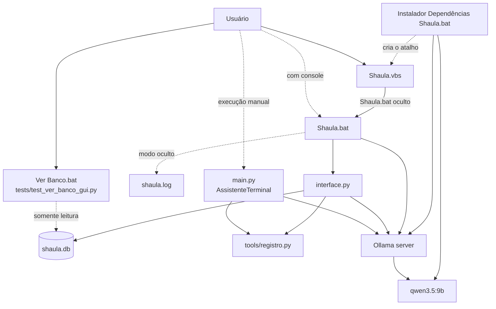

**Importante:** `main.py` não importa nem inicia `interface.py`. Os dois são entrypoints independentes que reutilizam o mesmo subsistema de ferramentas (e o mesmo `OrcamentoContexto`). Em `main.py` a lógica vive na classe `AssistenteTerminal`; nada executa no `import`.

**Duas formas de abrir a interface.** O atalho da Área de Trabalho (criado pelo instalador) aponta para `Shaula.vbs`, que roda `Shaula.bat oculto` com a janela invisível (`WScript.Shell.Run(..., 0, True)`) e espera a Shaula fechar; se o código de saída não for zero, mostra uma mensagem com as últimas linhas do registro. O `Shaula.bat` aberto direto mostra o console e espera uma tecla ao terminar. No modo `oculto`, o `.bat` nunca pausa e grava tudo o que o console mostraria em `%USERPROFILE%\.shaula\logs\shaula.log` (sobrescrito a cada abertura). A janela de console continua existindo, só invisível, então os programas de console abertos pelas ferramentas (`netsh`, `powershell`) dividem essa janela e não aparecem. A espera pelo Ollama usa `ping` em vez de `timeout`, que exige console interativo.

`Ver Banco.bat` abre `tests/test_ver_banco_gui.py` com o `pythonw.exe` do ambiente virtual: uma janela somente leitura (`PRAGMA query_only = ON`, só `SELECT`) que mostra as tabelas `conversas` e `mensagens` e se atualiza a cada segundo. Ele não importa nenhum módulo do projeto e, apesar do nome, não é um teste (o pytest não coleta nenhum caso dele).

### 2.1 Instalador — escolha do Python e instalação da voz

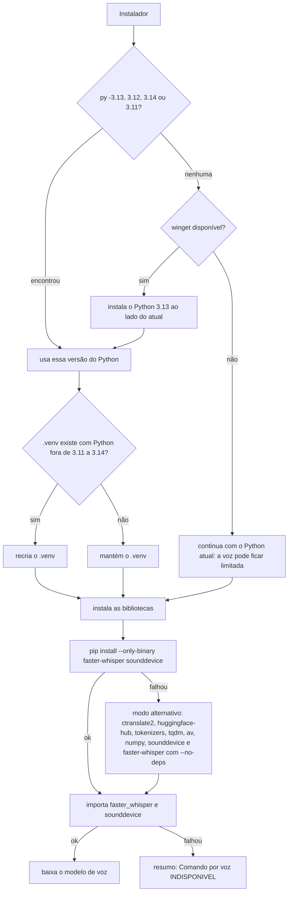

O motivo da escolha do Python: o `faster-whisper` depende do `onnxruntime`, que costuma levar meses para ter pacote em um Python recém-lançado. Sem ele, o `pip` volta para versões antigas do `faster-whisper`, tenta compilar o `av` e a instalação falha. O instalador usa `--only-binary=:all:` para nunca compilar nada, confere a instalação importando as bibliotecas de verdade e informa o resultado no resumo final (antes, dizia que a voz estava disponível mesmo quando a instalação falhava). Os dois `.bat` são entregues em ASCII com quebras de linha CRLF.

---

## 3. Núcleo de ferramentas

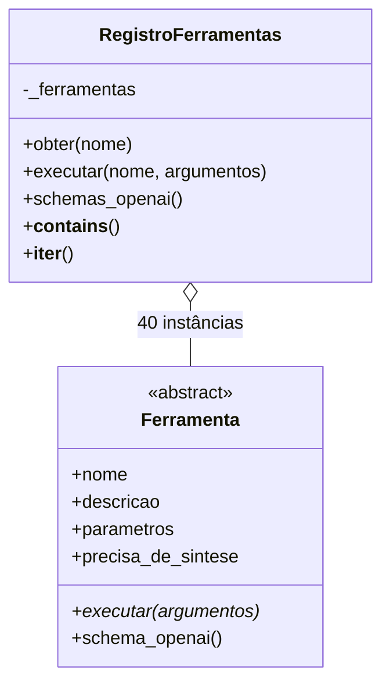

### 3.1 Ferramentas de cálculo — 10

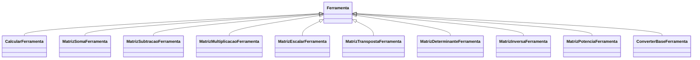

### 3.2 Ferramentas de sistema, arquivos e interação — 30

```mermaid
classDiagram
    Ferramenta <|-- AbrirProgramaFerramenta
    Ferramenta <|-- FecharProgramaFerramenta
    Ferramenta <|-- BuscarArquivoFerramenta
    Ferramenta <|-- AbrirArquivoFerramenta
    Ferramenta <|-- DesligarComputadorFerramenta
    Ferramenta <|-- CancelarDesligamentoFerramenta
    Ferramenta <|-- BloquearTelaFerramenta
    Ferramenta <|-- TestarPingFerramenta
    Ferramenta <|-- InformacoesHardwareFerramenta
    Ferramenta <|-- AbrirMenuIniciarFerramenta
    Ferramenta <|-- AtivarInternetFerramenta
    Ferramenta <|-- DesativarInternetFerramenta
    Ferramenta <|-- PesquisarInternetFerramenta
    Ferramenta <|-- ListarMonitoresFerramenta
    Ferramenta <|-- ListarJanelasAbertasFerramenta
    Ferramenta <|-- MoverProgramaMonitorFerramenta
    Ferramenta <|-- MoverParaOutroMonitorFerramenta
    Ferramenta <|-- TirarPrintFerramenta
    Ferramenta <|-- ControlarJanelaFerramenta
    Ferramenta <|-- CriarLembreteFerramenta
    Ferramenta <|-- ListarLembretesFerramenta
    Ferramenta <|-- CancelarLembreteFerramenta
    Ferramenta <|-- ListarProcessosFerramenta
    Ferramenta <|-- ListarProcessosProtegidosFerramenta
    Ferramenta <|-- FinalizarProcessoFerramenta
    Ferramenta <|-- CopiarTextoFerramenta
    Ferramenta <|-- ColarTextoFerramenta
    Ferramenta <|-- ObterIpLocalFerramenta
    Ferramenta <|-- VerificarWifiFerramenta
    Ferramenta <|-- AnalisarTelaFerramenta
```

---

## 4. Serviços e injeção de dependência

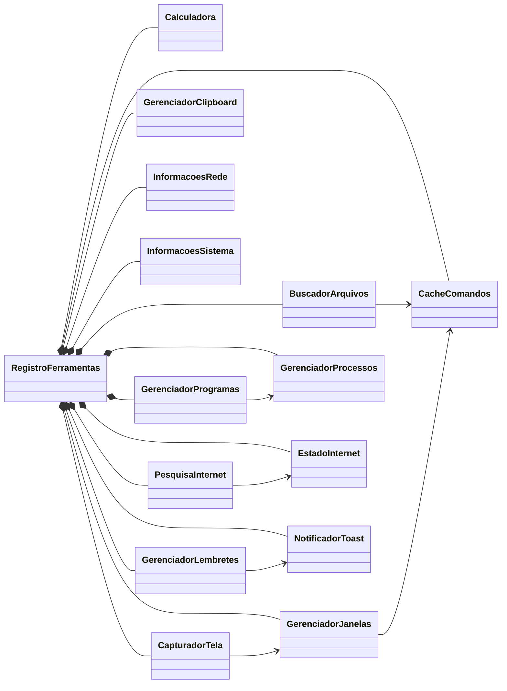

As ferramentas concretas recebem essas instâncias de serviço no construtor; elas não contêm a lógica principal do domínio.

### 4.1 Movimento de janelas entre monitores — GerenciadorJanelas

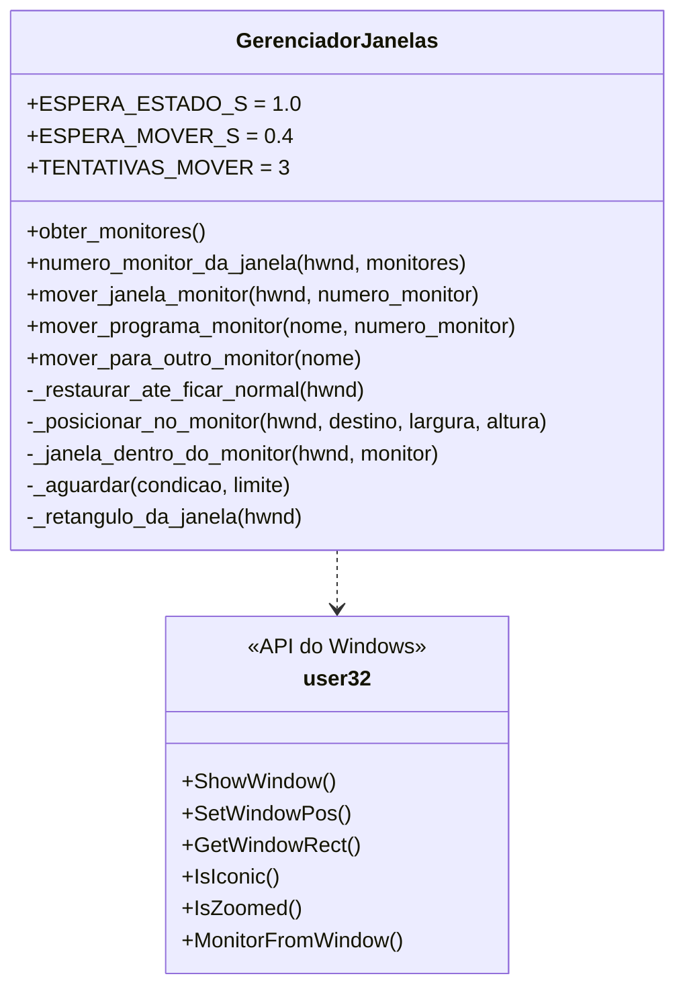

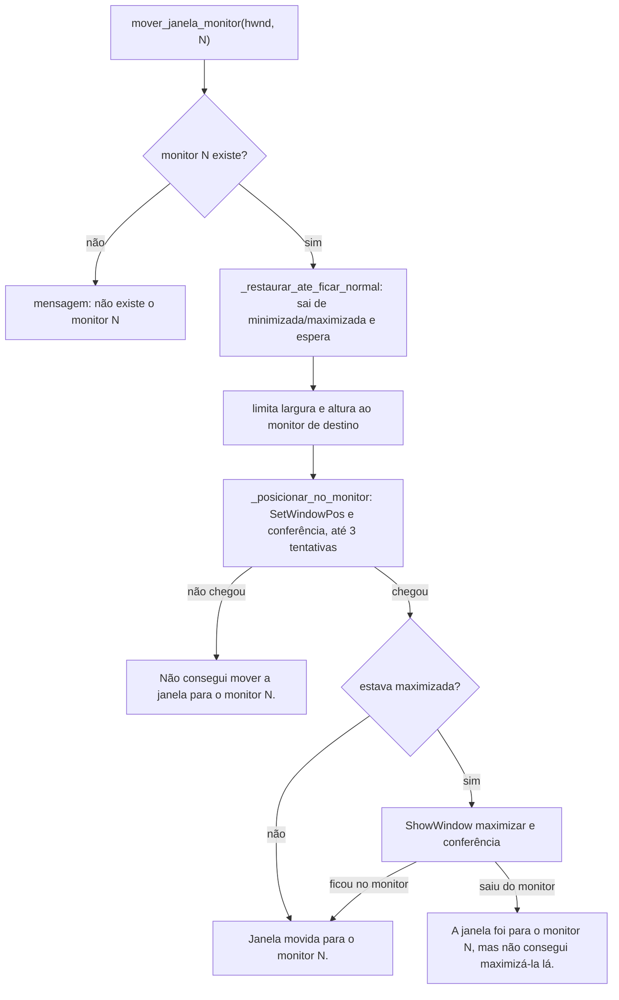

A conferência de chegada compara o centro da janela com o retângulo do monitor de destino. `numero_monitor_da_janela()` escolhe o monitor que cobre a maior parte da janela; só quando ela está fora de todos (minimizada) recorre ao identificador devolvido por `MonitorFromWindow`, porque esse inteiro (com sinal, 32 bits) pode não bater com o `HMONITOR` da enumeração de monitores. Só o resultado `Janela movida…` é tratado como sucesso por `mover_programa_monitor` (que então memoriza o monitor no `CacheComandos`) e por `mover_para_outro_monitor` (que então acrescenta o monitor de origem e de destino à resposta).

---

## 5. Mapeamento ferramenta → serviço

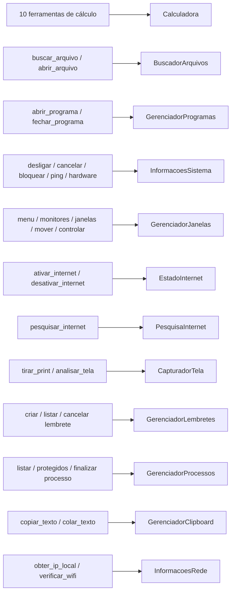

---

## 6. Pesquisa na internet — Strategy

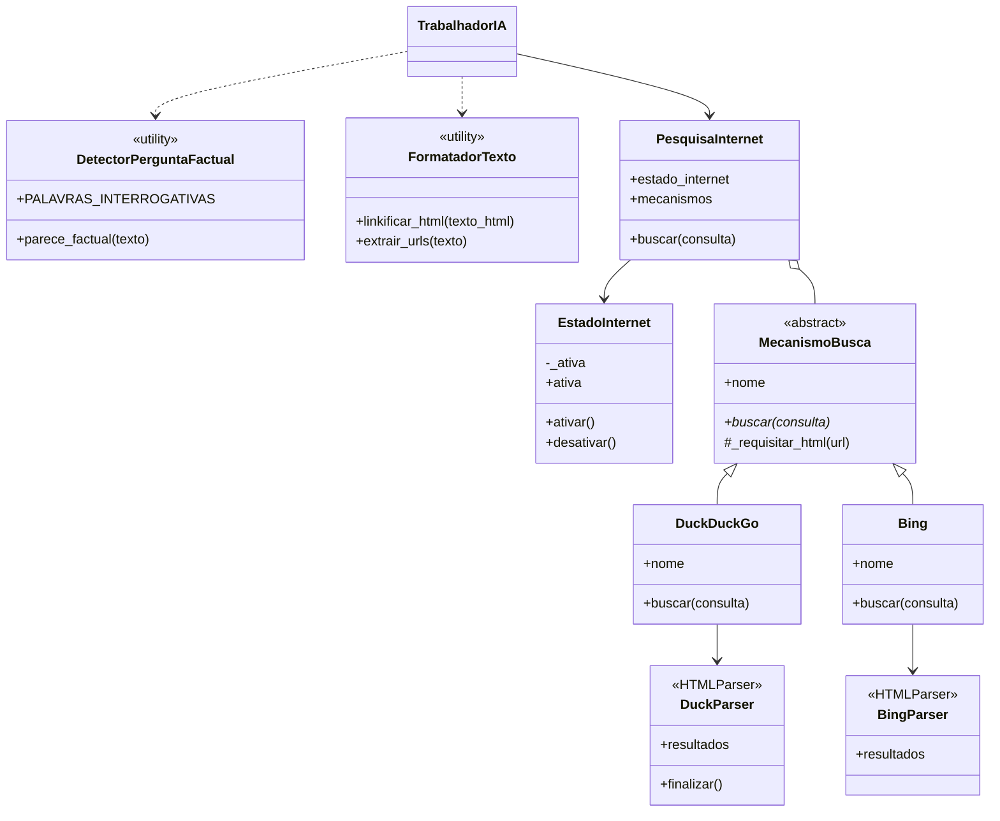

Ordem padrão de fallback: `DuckDuckGo()` e depois `Bing()`.

---

## 7. Anexos — Strategy

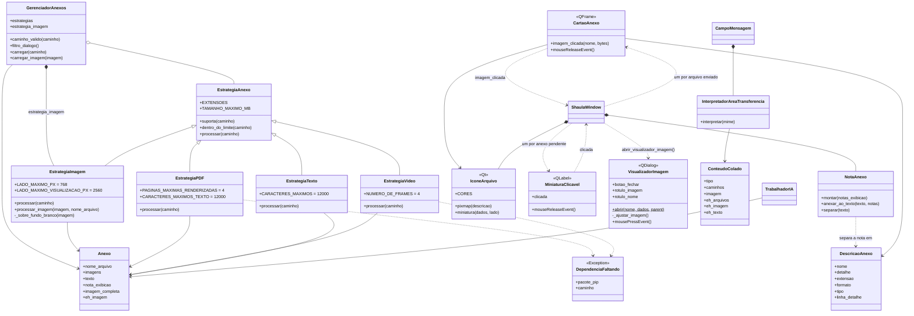

A nota `[N arquivo(s) anexado(s): ...]` é o que o modelo lê no histórico; a tela mostra, no lugar dela, um `CartaoAnexo` por arquivo (ícone, nome e formato). `NotaAnexo.separar()` tira a nota do texto, tanto na hora do envio quanto ao reabrir uma conversa antiga. `NotaAnexo` e `DescricaoAnexo` não dependem de Qt (`tools/nota_anexo.py`); `IconeArquivo`, `CartaoAnexo` e `MiniaturaClicavel` ficam em `tools/cartao_anexo.py`; `InterpretadorAreaTransferencia` e `ConteudoColado` ficam em `tools/area_transferencia.py` e `VisualizadorImagem` em `tools/visualizador_imagem.py`.

`Anexo.imagem_completa` é uma versão da imagem de até 2560 px que só a tela usa (o modelo recebe `imagens`, com 768 px). Só `EstrategiaImagem` a preenche; por isso o cartão de um PDF escaneado ou de um vídeo não é clicável. `EstrategiaImagem.processar_imagem()` serve tanto à imagem lida de um arquivo (`processar()`) quanto à colada (`GerenciadorAnexos.carregar_imagem()`), e coloca imagens com canal alfa sobre fundo branco antes de codificar em JPEG.

### 7.1 Colar com Ctrl+V e ampliar a imagem

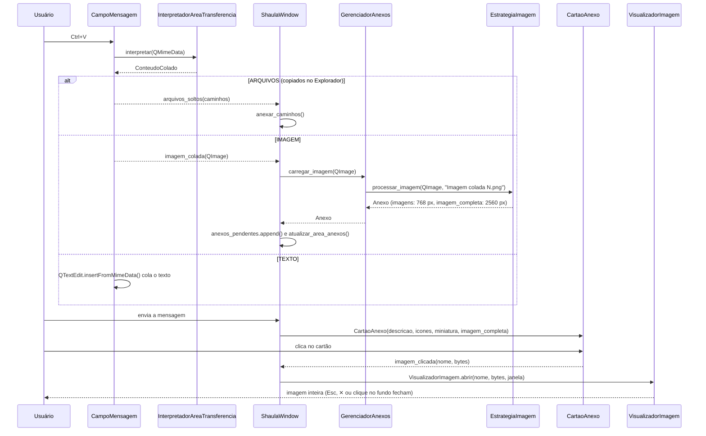

Prioridade do `InterpretadorAreaTransferencia`: arquivos locais que existem (`ARQUIVOS`); depois imagem (`IMAGEM`), exceto quando há texto não vazio e o HTML copiado não contém `` (células do Excel, por exemplo), caso em que vale o texto; o resto é `TEXTO`. Com o foco fora do campo de mensagem, o atalho `Ctrl+V` da `ShaulaWindow` (`atalho_colar`) leva o foco para o campo e chama `paste()`. A miniatura de um anexo pendente (`MiniaturaClicavel.clicada`) também abre o visualizador.

---

## 8. Comando por voz — Strategy

A voz não tem um "interpretador de comandos" próprio: o texto reconhecido segue o mesmo caminho de uma mensagem digitada (`enviar()` → `TrabalhadorIA` → tool-calling do modelo → `RegistroFerramentas`). Por isso o subsistema termina em texto.

A gravação **não encerra sozinha**: vai até a pessoa mandar parar (clique no microfone ou `Ctrl+M`), como num ditado. Só há dois controles: `finalizar()` (para e transcreve) e `cancelar()` (descarta). O único corte automático é um teto de segurança de 10 minutos.

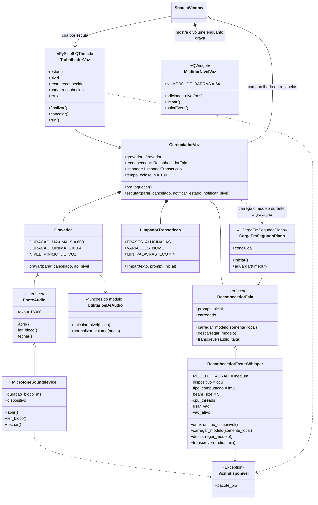

Pontos de polimorfismo: `Gravador` chama `fonte.ler_bloco()` sem saber se é um microfone real ou uma fonte falsa de teste, e `GerenciadorVoz` chama `reconhecedor.transcrever()` sem saber qual motor há por baixo — trocar o Whisper por outro motor (por exemplo, Vosk) é criar uma nova subclasse de `ReconhecedorFala`.

Filtro de silêncio (VAD): `transcrever()` passa `vad_filter=self.vad_ativo`. O parâmetro `usar_vad` é `None` por padrão, e então `vad_ativo` vale `onnxruntime_disponivel()` (um `importlib.util.find_spec("onnxruntime")`), porque o VAD do `faster-whisper` roda no `onnxruntime`, que nem todo Python tem (o `faster-whisper` importa normalmente sem ele; só o VAD levanta erro). Sem o `onnxruntime`, a voz funciona sem o filtro, e o `LimpadorTranscricao` continua descartando frases típicas de alucinação. `usar_vad=True` ou `False` força o comportamento. Se a biblioteca falta ou falha ao carregar (qualquer `ImportError`, inclusive de uma dependência como `ctranslate2`), `carregar_modelo()` levanta `VozIndisponivel` com o texto do erro real e a orientação de executar o instalador.

Fases da escuta na interface (`ShaulaWindow._fase_voz`): `None` → `iniciando` → `gravando` → (`preparando`, **só se o modelo ainda estiver carregando quando a fala termina**) → `transcrevendo` → `None`. O modelo é carregado em segundo plano (`_CargaEmSegundoPlano`) **enquanto a pessoa fala**; se a biblioteca faltar, o erro é avisado logo no início, antes da gravação. O pré-carregamento (`GerenciadorVoz.pre_aquecer()`, ~2 s depois de abrir a janela) está desligado por padrão (`PRE_AQUECER_VOZ = False`) e, quando ligado, só usa um modelo que já esteja no disco. Depois de `tempo_ocioso_s` (180 s) sem uso, `GerenciadorVoz` chama `descarregar_modelo()` para liberar a RAM; um novo uso cancela essa liberação agendada.

---

## 9. Interromper a resposta da IA — ChatInterrompivel

A Shaula usa `chat()` sem streaming (ver limitações no README): uma chamada assim bloqueia até o modelo terminar a resposta inteira, sem ponto intermediário para checar "o usuário mandou parar?". `ChatInterrompivel` resolve isso rodando a chamada de verdade numa thread auxiliar, enquanto quem chamou espera em intervalos de 50 ms conferindo o pedido de cancelamento.

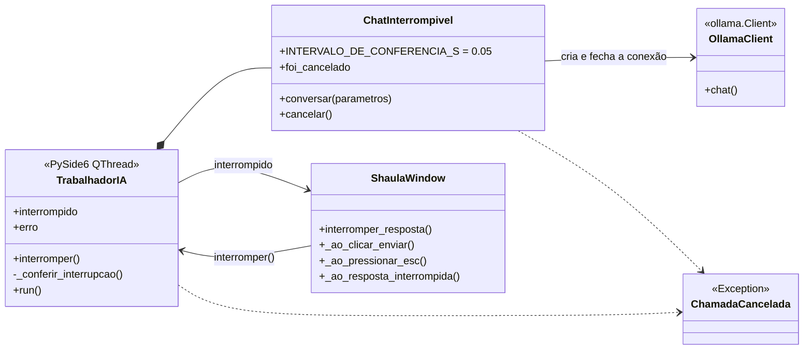

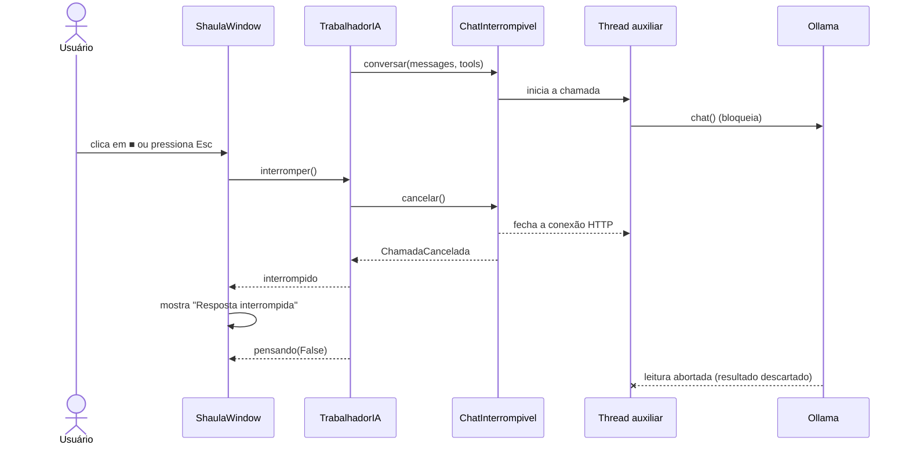

O botão de enviar (➤) vira "interromper" (■) enquanto a IA responde; `Esc` faz o mesmo (ou cancela a gravação de voz, se houver uma). O que interromper **não** faz: desfazer uma ferramenta que já executou — ela termina, o que devolveu é descartado e nenhuma outra é iniciada. A mensagem do usuário permanece no histórico; nenhuma resposta da IA é gravada (resultados de ferramentas nunca são gravados no histórico — existem só no contexto da troca).

### 9.1 Controle de contexto — OrcamentoContexto

O prompt de sistema (~1.700 tokens) e os 40 schemas (~4.100) ocupam cerca de 5.900 tokens antes de qualquer conversa, e a reserva de resposta sai do mesmo `num_ctx`. Se o total passar do `num_ctx`, o Ollama descarta o começo do prompt em silêncio. `OrcamentoContexto` evita isso antes de cada chamada: encurta respostas antigas longas (`CompactadorHistorico`), descarta as mais antigas e deixa um resumo do que saiu (`ResumidorHistorico`), para o histórico não sumir do contexto. Os dois colaboradores são injetados no construtor.

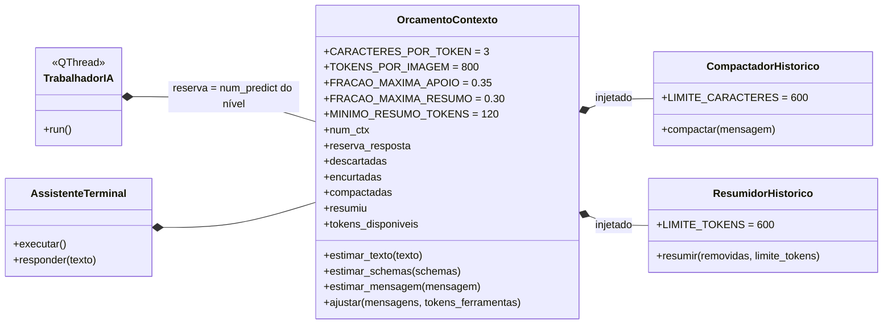

`ajustar()` devolve uma **nova** lista: preserva a mensagem de sistema do topo e tudo a partir da última mensagem do usuário; limita cada texto de apoio (`system`/`tool`) a 35% do orçamento; descarta as mensagens mais antigas do histórico até caber; e, se ainda faltar, encurta o maior texto de apoio.

Os parâmetros que variam com o nível de esforço (`think`, `num_ctx`, `num_predict` e o máximo de rodadas de ferramentas) vêm do `PerfilEsforco` (seção 9.2). Para mensagens com anexo, `tools` é omitido.

### 9.2 Nível de esforço — PerfilEsforco, CatalogoEsforco e EstadoEsforco

O botão **Esforço** da barra superior escolhe um de cinco perfis. `EstadoEsforco` é compartilhado por todas as janelas (como o `EstadoInternet`), é lembrado em `~/.shaula/configuracoes.json` (via `ArmazenamentoJson`) e, na primeira vez, pode ser iniciado pela variável `SHAULA_ESFORCO`.

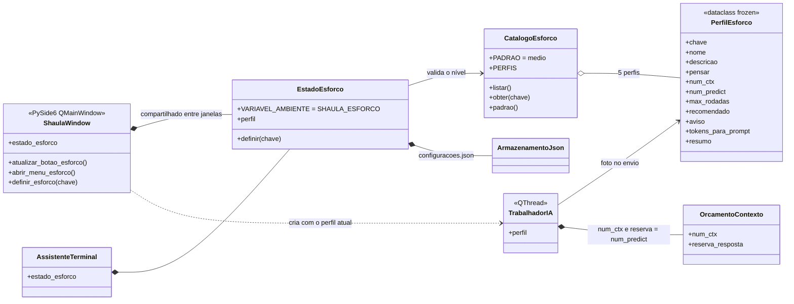

| Nível | `think` | `num_ctx` | `num_predict` | Rodadas |
|---|---|---|---|---|
| Baixo | não | 10240 | 1024 | 4 |
| Médio (recomendado) | sim | 11264 | 2048 | 8 |
| Alto | sim | 13312 | 3072 | 8 |
| Extra | sim | 15360 | 4096 | 10 |
| Máx | sim | 18432 | 6144 | 12 |

`TrabalhadorIA` recebe o perfil no momento do envio (uma "foto"): trocar o nível durante a resposta só vale para a próxima mensagem. Mudar o `num_ctx` faz o Ollama recarregar o modelo. Extra e Máx têm `aviso` de custo de VRAM para placas de 8 GB.

### 9.3 Blocos de código — DivisorDeBlocos, BlocoCodigo e ConteudoMensagemShaula

Respostas da Shaula com cercas ``` são exibidas como uma coluna de texto e blocos de código, cada bloco com cabeçalho (linguagem), botão **Copiar** e realce de sintaxe.

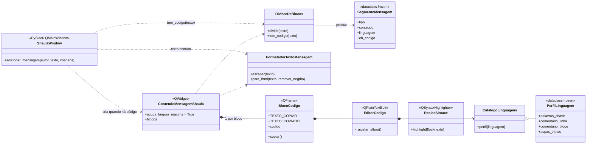

Pontos de projeto:

- `DivisorDeBlocos` não depende do Qt. Abre o bloco numa linha que começa com ``` ou ~~~ (até 8 espaços de recuo, que são removidos do código) e fecha com a mesma cerca; um bloco não fechado vai até o fim da mensagem, e um bloco vazio é descartado.
- O botão **Copiar** (`BlocoCodigo.copiar()`) usa `QGuiApplication.clipboard()` e mostra "✓ Copiado" por 1,8 s.
- `EditorCodigo` calcula a altura pelo layout real do documento (`blockBoundingRect`), não por `fontMetrics().lineSpacing()`, que cortava as últimas linhas; reserva a altura da barra horizontal quando ela aparece.
- O texto comum só tem `**` removido fora de crases (`FormatadorTextoMensagem`); o código nunca é alterado.
- `ConteudoMensagemShaula.ocupa_largura_maxima` faz `ShaulaWindow` usar a largura máxima (em vez de 45% da janela) para esse balão, inclusive em `aplicar_redimensionamento()`.

---

### 9.4 Confirmação de ações sensíveis — PoliticaConfirmacao e Confirmador

Antes de executar uma ferramenta, `RegistroFerramentas.executar()` pergunta à `PoliticaConfirmacao` se a chamada precisa de confirmação; se precisar, delega a um `Confirmador`. A resposta padrão é **não**.

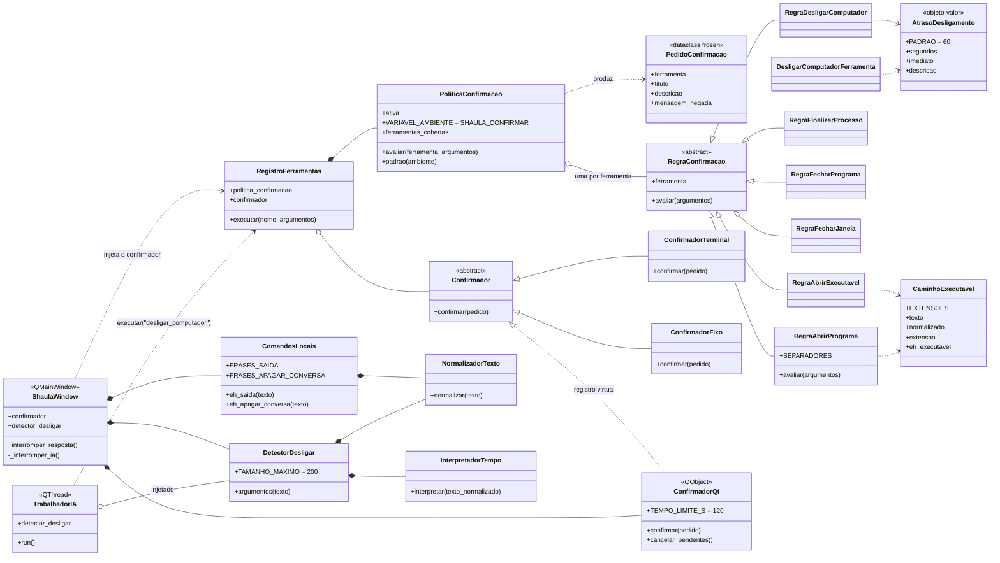

```mermaid
sequenceDiagram
    participant T as TrabalhadorIA (thread da IA)
    participant R as RegistroFerramentas
    participant P as PoliticaConfirmacao
    participant C as ConfirmadorQt
    participant J as Thread da interface
    participant U as Usuário
    participant F as Ferramenta

    T->>R: executar("fechar_programa", {nome})
    R->>P: avaliar(nome, argumentos)
    P-->>R: PedidoConfirmacao
    R->>C: confirmar(pedido)
    C->>J: sinal (fila) com o pedido
    Note over T,C: a thread da IA espera (máx. 120 s)
    J->>U: caixa "Sim, autorizar" / "Não"
    alt Sim
        U-->>J: Sim
        J-->>C: resposta = True
        C-->>R: True
        R->>F: executar(argumentos)
        F-->>T: resultado
    else Não, fechar, Esc, ■, janela fechada ou tempo esgotado
        J-->>C: resposta = False
        C-->>R: False
        R-->>T: "Ação cancelada: você não autorizou…"
    end
```

Atalho para o pedido direto de desligar (sem passar pelo modelo):

```mermaid
sequenceDiagram
    participant T as TrabalhadorIA
    participant D as DetectorDesligar
    participant R as RegistroFerramentas
    participant C as ConfirmadorQt
    participant U as Usuário

    T->>D: argumentos("desligue o computador")
    D-->>T: {}  (ou None se não for um pedido claro)
    T->>R: executar("desligar_computador", {})
    R->>C: confirmar(pedido: "em 60 segundo(s)")
    C->>U: caixa à frente (restaura a janela, topo, pisca)
    U-->>C: Sim / Não
    C-->>R: resposta
    R-->>T: resultado ou "Ação cancelada…"
    T-->>T: devolve direto, sem chamar o modelo
```

Pontos de projeto:

- Cobertura: `desligar_computador`, `finalizar_processo`, `fechar_programa`, `controlar_janela` (só com `acao = fechar`) e `abrir_arquivo` (só para extensões de programa ou script).
- Sem confirmador configurado, a ação sensível é **recusada**. `SHAULA_CONFIRMAR=0` desliga a política.
- `ConfirmadorQt` não herda de `Confirmador`, porque a metaclasse do `QObject` não se combina com a ABC; é registrado como subclasse virtual. `ShaulaWindow.interromper_resposta()` (botão ■) e `_interromper_ia()` (fechamento da janela) chamam `cancelar_pendentes()` para não ficarem presos à caixa.
- **Atalho `DetectorDesligar`** (`tools/intencao_desligar.py`): o modelo local às vezes não chama a ferramenta, e sem chamada não há confirmação. O detector reconhece frases curtas e inequívocas sobre desligar o computador e o `TrabalhadorIA` chama o registro direto, antes do modelo. Não dispara com perguntas, negações, textos longos ou mensagens com anexo. O atalho não pula a confirmação: só garante que ela aconteça. Os outros pedidos sensíveis não têm atalho. Os colaboradores (`NormalizadorTexto`, `InterpretadorTempo`) são injetáveis.
- `desligar_computador` tem `segundos` opcional: `AtrasoDesligamento` (ausente/inválido → 60; `0` → agora) é usada tanto pela regra de confirmação quanto pela ferramenta, para a pergunta bater com a ação.
- `ConfirmadorQt._exibir()` traz a caixa para a frente (restaura a janela minimizada, `WindowStaysOnTopHint`, `activateWindow`, `QApplication.alert`).
- A caixa tem estilo próprio (`ESTILO_CAIXA`): o `QWidget { color }` da janela pintaria o texto de branco sobre o fundo claro do sistema.

### 9.5 Captura para o modelo — analisar_tela

```mermaid
classDiagram
    direction LR

    class AnalisarTelaFerramenta {
        +nome = analisar_tela
        +precisa_de_sintese = True
        +executar(argumentos)
    }

    class CapturadorTela {
        +LADO_MAXIMO_ANALISE_PX = 1024
        +tirar_print(...)
        +capturar_para_modelo(monitor, ocultar_shaula)
        -_salvar_imagem(cabecalho, pixels, sufixo)
    }

    class ImagemCapturada {
        +largura
        +altura
        +para_qimage()
        +salvar_png(caminho)
        +para_jpeg(lado_maximo)
    }

    class CapturaParaModelo {
        <<dataclass frozen>>
        +imagens
        +numero_monitor
        +largura
        +altura
        +shaula_ocultada
    }

    class ResultadoComImagens {
        <<str>>
        +imagens
    }

    class OcultadorJanelasProprias {
        +ESPERA_PADRAO_S = 0.4
        +intersecta(a, b)
        +ocultar(regiao)
    }

    class ApiJanelasWin32 {
        +janelas_visiveis_do_processo(pid)
        +retangulo(hwnd)
        +minimizar(hwnd)
        +restaurar(hwnd)
    }

    class TrabalhadorIA {
        <<QThread>>
        +run()
    }

    AnalisarTelaFerramenta --> CapturadorTela
    AnalisarTelaFerramenta ..> ResultadoComImagens : devolve
    CapturadorTela *-- OcultadorJanelasProprias
    CapturadorTela ..> ImagemCapturada
    CapturadorTela ..> CapturaParaModelo
    OcultadorJanelasProprias o-- ApiJanelasWin32
    TrabalhadorIA ..> ResultadoComImagens : lê .imagens
```

- `ImagemCapturada` converte o buffer do GDI (BGRA, linhas de baixo para cima) em `QImage` já na orientação certa e a salva em **PNG** (os prints deixaram de ser BMP) ou a codifica em **JPEG** reduzido. Usa só `QImage`, seguro em qualquer thread.
- `OcultadorJanelasProprias.ocultar(regiao)` minimiza só as janelas do próprio processo que **intersectam** o monitor capturado e as restaura num `finally`. `ApiJanelasWin32` usa uma instância própria da `user32` com `argtypes`/`restype`; fora do Windows tudo vira no-op.
- O Ollama não aceita imagens em mensagens de ferramenta. `TrabalhadorIA` lê `.imagens` do `ResultadoComImagens`, adiciona uma mensagem de **usuário** com a imagem e o pedido original, e remove os schemas nas chamadas seguintes da troca (`schemas = []`), para a imagem caber no contexto. A imagem nunca é persistida no histórico.

---

### 9.6 Garantia de ação — DetectorAcaoSemFerramenta

```mermaid
classDiagram
    direction TB

    class TrabalhadorIA {
        <<QThread>>
        +detector_acao: DetectorAcaoSemFerramenta
        +run()
    }

    class DetectorAcaoSemFerramenta {
        +LIMITE_CARACTERES = 220
        +AFIRMACAO
        +MENSAGEM_CORRECAO
        +AVISO
        +afirma_acao(texto)
        +mensagem_de_correcao()
        +com_aviso(texto)
    }

    class RegistroFerramentas {
        +executar(nome, argumentos)
    }

    TrabalhadorIA o-- DetectorAcaoSemFerramenta : injetado
    TrabalhadorIA --> RegistroFerramentas
```

```mermaid
sequenceDiagram
    participant T as TrabalhadorIA
    participant O as Ollama/Qwen
    participant D as DetectorAcaoSemFerramenta
    participant R as RegistroFerramentas

    T->>O: chat(messages, tools)
    O-->>T: "Firefox movido para o monitor 1." (sem tool_calls)
    T->>D: afirma_acao(texto)
    D-->>T: True (e nenhuma ferramenta rodou na troca)
    T->>T: descarta a resposta e adiciona a mensagem de correção (system)
    T->>O: chat(messages, tools)

    alt o modelo chama a ferramenta
        O-->>T: tool_calls
        T->>R: executar("mover_programa_monitor", argumentos)
        R-->>T: "Janela movida para o monitor 1."
    else o modelo repete o texto
        O-->>T: "Firefox movido para o monitor 1."
        T->>D: com_aviso(texto)
        D-->>T: texto + aviso ⚠️
        T-->>T: resposta final, com o aviso
    end
```

Modelos locais pequenos às vezes respondem como se tivessem executado uma ação sem chamar a ferramenta, e o histórico (que guarda só o texto final) reforça o hábito. A verificação roda em `TrabalhadorIA.run()`, no ramo "sem `tool_calls`", e só vale quando: há schemas de ferramenta na troca (não é uma mensagem com anexo), nenhuma ferramenta foi executada nela e a resposta é curta (até 220 caracteres) com um verbo de ação no particípio ou gerúndio (`movido`, `aberto`, `fechado`, `finalizado`, `encerrado`, `apagado`, `criado`, `ajustado`, `iniciando` e semelhantes). A correção é pedida uma vez por troca; se o modelo insistir, a resposta sai com o aviso em vez de afirmar um sucesso que não aconteceu. A heurística é de propósito simples: um falso positivo só custa uma nova geração, e o texto da correção manda responder normalmente quando o pedido não era uma ação.

---

## 10. Conversas e persistência

```mermaid
classDiagram
    direction TB

    class ShaulaWindow {
        +id_conversa_atual
        +historico
        +selecionar_conversa()
        +criar_nova_conversa()
        +renomear_conversa_ui()
        +apagar_conversa_ui()
        +abrir_conversa_em_nova_janela()
    }

    class GerenciadorConversas {
        +TITULO_PADRAO
        +TAMANHO_TITULO_AUTOMATICO
        +NOME_ARQUIVO_BANCO = "shaula.db"
        +repositorio: RepositorioConversas
        +listar_conversas()
        +criar_conversa()
        +obter_entrada(id)
        +obter_historico(id)
        +renomear_conversa()
        +alternar_fixado()
        +apagar_conversa()
        +resetar_titulo()
        +marcar_atualizada()
        +atualizar_titulo_automatico()
    }

    class RepositorioConversas {
        +banco: BancoSqlite
        +inserir(id, titulo)
        +listar()
        +obter(id)
        +renomear(id, titulo)
        +alternar_fixado(id)
        +apagar(id)
        +redefinir_titulo(id, titulo)
        +definir_titulo_automatico(id, titulo)
        +marcar_atualizada(id)
        +mensagens_da(id)
        +carregar_mensagens(id)
        +gravar_mensagens(id, mensagens)
        +apagar_mensagens(id)
    }

    class MensagensSqlite {
        +id_conversa
        +existe()
        +ler(padrao)
        +gravar(dados)
        +remover()
    }

    class BancoSqlite {
        +VERSAO_ESQUEMA = 1
        +ESPERA_POR_TRAVA_S = 10
        +caminho
        +leitura()
        +transacao()
    }

    class HistoricoConversa {
        +MAX_MENSAGENS_HISTORICO = 60
        +mensagem_sistema
        +caminho_arquivo
        +mensagens
        +adicionar()
        +salvar()
        +apagar()
    }

    class ArmazenamentoJson {
        +trava
        +ler(padrao)
        +gravar(dados)
        +remover()
    }

    ShaulaWindow --> GerenciadorConversas
    ShaulaWindow --> HistoricoConversa : atual
    GerenciadorConversas --> HistoricoConversa : obter_historico()
    GerenciadorConversas *-- RepositorioConversas
    RepositorioConversas *-- BancoSqlite
    RepositorioConversas ..> MensagensSqlite : mensagens_da()
    MensagensSqlite --> RepositorioConversas
    HistoricoConversa o-- MensagensSqlite : armazenamento (conversa no banco)
    HistoricoConversa o-- ArmazenamentoJson : armazenamento (arquivo JSON, uso avulso)
    CacheComandos *-- ArmazenamentoJson
```

Modelo de dados (`shaula.db`, esquema versão 1):

```mermaid
erDiagram
    CONVERSAS ||--o{ MENSAGENS : possui

    CONVERSAS {
        TEXT id PK
        TEXT titulo
        INTEGER titulo_automatico
        INTEGER fixado
        TEXT criado_em
        TEXT atualizado_em
    }

    MENSAGENS {
        INTEGER id PK
        TEXT conversa_id FK
        TEXT papel
        TEXT conteudo
        TEXT criado_em
    }
```

Localização padrão: `~/.shaula/conversas/shaula.db`.

Responsabilidades:

- **`BancoSqlite`** (`tools/banco_dados.py`) abre uma conexão por operação (uma conexão SQLite não pode ser usada por threads diferentes, e a Shaula tem várias threads e janelas no mesmo processo), liga `PRAGMA foreign_keys`, usa journal WAL e cria o esquema na primeira execução, registrando a versão em `PRAGMA user_version`. `transacao()` faz `BEGIN IMMEDIATE`, confirma no fim e desfaz tudo se algo falhar; `leitura()` é para consultas.
- **`RepositorioConversas`** (`tools/repositorio_conversas.py`) concentra todo o SQL, sempre com parâmetros (`?`), nunca com valores montados dentro do comando. `listar()` ordena as fixadas primeiro e, dentro de cada grupo, as mais recentes antes. `gravar_mensagens()` faz o banco ficar igual à lista recebida numa só transação: se a lista só ganhou mensagens no final, insere apenas as novas (as antigas mantêm `id` e data); se mudou de outro jeito (o limite de 60 descartou as mais antigas), reescreve a conversa. Devolve `False`, sem gravar nada, se a conversa não existe mais (apagada em outra janela).
- **`MensagensSqlite`** adapta as mensagens de uma conversa à interface do `ArmazenamentoJson` (`ler`, `gravar`, `remover`, `existe`), e é isso que permite ao `HistoricoConversa` trocar o arquivo pelo banco sem mudar a lógica dele.
- **`GerenciadorConversas`** guarda só as regras: título padrão e automático, o que conta como atualizada e qual histórico entregar a cada janela. Não guarda nada em memória entre chamadas: todas as janelas consultam o mesmo banco.
- **`HistoricoConversa`** persiste só mensagens `user` e `assistant`, no máximo 60. Aceita qualquer armazenamento com `ler`/`gravar`/`remover` (parâmetro `armazenamento`); sem ele usa um arquivo JSON.

Integridade: `mensagens.conversa_id` referencia `conversas.id` com `ON DELETE CASCADE`, então apagar uma conversa apaga as mensagens dela; `mensagens.papel` tem `CHECK (papel IN ('user', 'assistant'))`; uma gravação que viole isso é desfeita por inteiro. Não há migração dos JSON das versões anteriores (`indice.json`, `<id>.json`, `historico_conversa.json`): esses arquivos não são lidos nem apagados. O banco pode ser inspecionado pelo `Ver Banco.bat` (veja a seção 2).

`ArmazenamentoJson` continua em uso para o resto: grava de forma **atômica** (arquivo temporário + `os.replace`, com novas tentativas no Windows), mantém uma trava reentrante por caminho compartilhada por todas as janelas, e leituras de arquivo ausente, corrompido ou com bytes inválidos devolvem o valor padrão. É usado por `CacheComandos`, `EstadoEsforco` (`configuracoes.json`), `GerenciadorLembretes` (`lembretes.json`) e pela busca de arquivos.

### 10.1 Lembretes persistentes

`GerenciadorLembretes` grava os lembretes pendentes em `~/.shaula/lembretes.json` com `ArmazenamentoJson`; **o arquivo é a fonte da verdade e os `threading.Timer` são só despertadores**.

```mermaid
classDiagram
    direction LR

    class GerenciadorLembretes {
        +ATRASO_INICIAL_ENTREGA_S = 2.0
        +INTERVALO_ENTRE_ATRASADOS_S = 1.5
        +criar_lembrete(texto, tempo, unidade)
        +listar_lembretes()
        +cancelar_lembrete(id)
        +restaurar()
        -_disparar(id, atrasado)
        -_agendar(id, segundos, atrasado)
    }

    class ArmazenamentoJson {
        +trava
        +ler(padrao)
        +gravar(dados)
    }

    class NotificadorToast {
        +notificar(titulo, texto)
    }

    GerenciadorLembretes *-- ArmazenamentoJson : lembretes.json
    GerenciadorLembretes *-- NotificadorToast
```

- **Restaurar (ao abrir):** o que ainda vai acontecer é reagendado; o que venceu com a Shaula fechada é entregue **uma vez**, como "(atrasado)", escalonado e depois de a janela subir.
- **Disparar:** dentro da trava do arquivo, o lembrete é removido **antes** de ser entregue. Duas janelas com um `Timer` para o mesmo lembrete entregam uma só vez, e um lembrete cancelado em outra janela não dispara.
- **Listar e cancelar** leem/alteram o arquivo, então valem para todas as janelas. Os ids continuam de onde o arquivo parou.
- O horário é gravado com precisão total (guardar só os segundos fazia lembretes curtos nascerem atrasados).

---

## 11. Sequência de uma mensagem na GUI

```mermaid
sequenceDiagram
    participant U as Usuário
    participant G as ShaulaWindow
    participant A as GerenciadorAnexos
    participant H as HistoricoConversa
    participant T as TrabalhadorIA
    participant P as PesquisaInternet
    participant O as Ollama/Qwen
    participant R as RegistroFerramentas
    participant F as Ferramenta

    U->>G: enviar texto/anexos
    G->>A: carregar anexos pendentes
    A-->>G: Anexo(s)
    G->>H: adicionar(user, texto + nota de anexos)
    G->>T: cria e inicia thread

    opt Pedido claro de desligar (sem anexo)
        T->>T: DetectorDesligar.argumentos(texto)
        T->>R: executar("desligar_computador", argumentos) com confirmação
        R-->>T: resultado
        T-->>G: resultado direto (o modelo não é chamado)
    end

    T->>T: adiciona estado atual da internet
    T->>T: isola texto de anexos como referência

    opt Internet ON + pergunta factual + sem anexos
        T->>P: buscar(pergunta)
        P-->>T: resultados + URLs
        T->>T: adiciona RESULTADO DE PESQUISA AUTOMÁTICA
    end

    loop Até resposta final (no máx. 8 rodadas)
        T->>T: OrcamentoContexto.ajustar(messages)
        T->>O: chat(messages, tools*, options, think)
        Note over T,O: *tools omitido quando há anexo
        O-->>T: resposta / tool_calls

        alt Há tool_calls
            loop Para cada chamada
                T->>R: executar(nome, argumentos)
                R->>F: executar(argumentos)
                F-->>R: resultado
                R-->>T: resultado
                T->>T: resultado tool fica só no contexto da troca
            end

            alt nenhuma ferramenta precisa de síntese
                T-->>G: resultados diretos
            else alguma precisa de síntese
                T->>O: próxima rodada com resultado tool
            end
        else Sem tool_call
            opt nenhuma ferramenta rodou na troca e a resposta afirma uma ação
                T->>T: DetectorAcaoSemFerramenta.afirma_acao(texto)
                Note over T: 1ª vez: descarta a resposta, adiciona a correção e faz nova rodada
                Note over T: 2ª vez: a resposta segue com o aviso ⚠️
            end
            T->>T: garante fontes quando aplicável
            T-->>G: resposta final
        end
    end

    alt resposta final
        G->>H: adicionar(assistant, resposta)
        G->>H: salvar()
    else falha / resposta vazia / limite de rodadas
        T-->>G: erro (sinal separado)
        Note over G,H: exibido com ⚠, não vai ao histórico
    end
    G-->>U: exibir resposta
```

---

## 12. Interface gráfica

```mermaid
classDiagram
    direction TB

    class ShaulaWindow {
        <<QMainWindow>>
        +criar_interface()
        +renderizar_historico_salvo()
        +atualizar_lista_conversas()
        +selecionar_conversa()
        +criar_nova_conversa()
        +abrir_dialogo_anexo()
        +anexar_caminhos()
        +anexar_imagem_colada()
        +abrir_visualizador_imagem()
        +enviar()
        +alternar_escuta()
        +receber_resposta()
        +alternar_internet()
        +fechar_shaula()
    }

    class CampoMensagem {
        <<QTextEdit>>
        +enviar_mensagem
        +arquivos_soltos
        +imagem_colada
        +ajustar_altura()
        +keyPressEvent()
        +dragEnterEvent()
        +dropEvent()
        +canInsertFromMimeData()
        +insertFromMimeData()
    }

    class CartaoAnexo {
        <<QFrame>>
        +imagem_clicada
    }

    class MiniaturaClicavel {
        <<QLabel>>
        +clicada
    }

    class VisualizadorImagem {
        <<QDialog>>
        +abrir(nome, dados, parent)$
    }

    class TrabalhadorIA {
        <<QThread>>
        +detector_desligar
        +detector_acao
        +resposta_pronta
        +erro
        +pensando
        +interrompido
        +interromper()
        +run()
    }

    class TrabalhadorVoz {
        <<QThread>>
        +estado
        +nivel
        +texto_reconhecido
        +nada_reconhecido
        +erro
        +finalizar()
        +cancelar()
        +run()
    }

    class MedidorNivelVoz {
        <<QWidget>>
        +adicionar_nivel(rms)
        +limpar()
    }

    class MenuPrincipal {
        +instalar()
        +tem_ferramenta(nome)
        +criar_acao()
    }

    class TrabalhadorFerramenta {
        <<QThread>>
        +concluido
        +interromper()
        +run()
    }

    ShaulaWindow *-- CampoMensagem
    ShaulaWindow ..> CartaoAnexo : um por arquivo enviado
    ShaulaWindow ..> MiniaturaClicavel : um por anexo pendente
    ShaulaWindow ..> VisualizadorImagem : abre ao clicar na imagem
    ShaulaWindow --> TrabalhadorIA
    ShaulaWindow --> TrabalhadorVoz
    ShaulaWindow *-- MedidorNivelVoz
    ShaulaWindow *-- MenuPrincipal : barra de menus
    ShaulaWindow --> TrabalhadorFerramenta : itens do menu
    CampoMensagem --> ShaulaWindow : sinais (enviar_mensagem, arquivos_soltos, imagem_colada)
    CartaoAnexo --> ShaulaWindow : imagem_clicada
    MiniaturaClicavel --> ShaulaWindow : clicada
    TrabalhadorIA --> ShaulaWindow : resposta_pronta / erro / pensando / interrompido
    TrabalhadorVoz --> ShaulaWindow : texto_reconhecido / estado / nivel / erro
```

### 12.1 Menu principal — orientado a objetos

A janela tem uma barra de menus (`tools/menu_principal.py`) que dá acesso a todas as funcionalidades. O módulo foi desenhado com classes, herança e polimorfismo, sem `if/elif` por tipo e sem funções soltas: cada comportamento fica na classe responsável por ele.

#### Catálogo do menu — padrão Composite

`ItemMenu` é a base abstrata de tudo o que aparece num menu. `Submenu` contém outros `ItemMenu` (inclusive outros `Submenu`), então a árvore de menus é percorrida da mesma forma em todos os níveis. As ferramentas que dependem do modelo especializam `ItemPeloChat` e mudam só a forma de executar.

```mermaid
classDiagram
    direction TB

    class ItemMenu {
        <<abstract>>
        +adicionar_em(menu, menu_principal)*
        +nomes_de_ferramentas()*
    }

    class Separador {
        +adicionar_em(menu, menu_principal)
        +nomes_de_ferramentas()
    }

    class ItemFerramenta {
        +nome
        +rotulo
        +campos
        +rotulo_limpo
        +adicionar_em(menu, menu_principal)
        +nomes_de_ferramentas()
        +executar(executor, argumentos)
    }

    class ItemPeloChat {
        <<abstract>>
        +montar_texto(argumentos)*
        +executar(executor, argumentos)
    }

    class ItemPesquisaInternet {
        +montar_texto(argumentos)
    }

    class ItemAnalisarTela {
        +montar_texto(argumentos)
    }

    class Submenu {
        +rotulo
        +itens
        +preencher(menu, menu_principal)
        +adicionar_em(menu, menu_principal)
        +nomes_de_ferramentas()
    }

    class CatalogoMenu {
        +FERRAMENTAS_DO_LIGA_DESLIGA
        +menus()
        +menu_rede()
        +nomes_cobertos()
    }

    ItemMenu <|-- Separador
    ItemMenu <|-- ItemFerramenta
    ItemMenu <|-- Submenu
    ItemFerramenta <|-- ItemPeloChat
    ItemPeloChat <|-- ItemPesquisaInternet
    ItemPeloChat <|-- ItemAnalisarTela
    Submenu o-- ItemMenu : itens
    CatalogoMenu ..> Submenu : cria os menus
```

`ItemFerramenta.executar()` manda executar a ferramenta direto, em thread. `ItemPeloChat.executar()` sobrescreve esse método e envia uma frase pelo chat, para `pesquisar_internet` e `analisar_tela`, que precisam do modelo. Quem chama não precisa saber qual dos dois é: é o polimorfismo de `executar()`.

#### Formulário de parâmetros — Factory e Template Method

Cada parâmetro do esquema JSON da ferramenta vira um `CampoParametro`. `FabricaDeCampos` escolhe a subclasse certa, e `CampoParametro.valor()` é um template method: lê o texto, trata o campo vazio e delega a conversão à subclasse.

```mermaid
classDiagram
    direction TB

    class CampoParametro {
        <<abstract>>
        +chave
        +esquema
        +obrigatorio
        +rotulo
        +widget
        #_criar_widget()*
        #_ler_texto()*
        #_converter(texto)*
        +valor()
    }

    class CampoTexto
    class CampoInteiro
    class CampoNumero
    class CampoMatriz
    class CampoOpcoes {
        +valor()
    }
    class CampoBooleano

    class FabricaDeCampos {
        +criar(chave, esquema, obrigatorio)$
    }

    class LeitorMatriz {
        +ler(texto)$
    }

    class DialogoParametros {
        <<QDialog>>
        -_campos
        -_validar()
        +argumentos()
    }

    CampoParametro <|-- CampoTexto
    CampoTexto <|-- CampoInteiro
    CampoTexto <|-- CampoNumero
    CampoParametro <|-- CampoMatriz
    CampoParametro <|-- CampoOpcoes
    CampoOpcoes <|-- CampoBooleano
    FabricaDeCampos ..> CampoParametro : cria
    DialogoParametros *-- CampoParametro : um por parâmetro
    DialogoParametros ..> FabricaDeCampos
    CampoMatriz ..> LeitorMatriz
```

#### Montagem e execução

`MenuPrincipal` só monta a barra. A execução dos itens fica em `ExecutorMenu`, os submenus que mudam a cada abertura herdam de `SubmenuDinamico`, e as ações sobre a conversa aberta ficam em `AcoesDaConversaAtual`.

```mermaid
classDiagram
    direction TB

    class ShaulaWindow {
        <<QMainWindow>>
        +menu_principal
        +trabalhador
        +registro
        +receber_resposta()
    }

    class MenuPrincipal {
        +catalogo
        +executor
        +acoes_da_conversa
        +submenu_conversas
        +submenu_esforco
        +instalar()
        +tem_ferramenta(nome)
        +criar_acao(menu, texto, funcao, atalho, marcavel)
    }

    class ExecutorMenu {
        +ocupada()
        +acionar(item)
        +enviar_pelo_chat(texto)
        +executar_em_thread(item, argumentos)
        +texto_do_pedido(item, argumentos)$
    }

    class TrabalhadorFerramenta {
        <<QThread>>
        +concluido
        +interromper()
        +run()
    }

    class SubmenuDinamico {
        <<abstract>>
        +instalar_em(menu_pai, titulo)
        +preencher()*
    }

    class SubmenuConversas {
        +preencher()
        +ir_para(id_conversa)
    }

    class SubmenuEsforco {
        +preencher()
    }

    class AcoesDaConversaAtual {
        +entrada()
        +esta_fixada()
        +renomear()
        +alternar_fixacao()
        +apagar()
    }

    class DialogoFerramentas {
        <<QDialog>>
    }

    class RegistroFerramentas
    class GerenciadorConversas
    class CatalogoEsforco

    ShaulaWindow *-- MenuPrincipal
    MenuPrincipal *-- CatalogoMenu
    MenuPrincipal *-- ExecutorMenu
    MenuPrincipal *-- AcoesDaConversaAtual
    MenuPrincipal *-- SubmenuConversas
    MenuPrincipal *-- SubmenuEsforco
    MenuPrincipal ..> DialogoFerramentas : Ajuda
    SubmenuDinamico <|-- SubmenuConversas
    SubmenuDinamico <|-- SubmenuEsforco
    ExecutorMenu --> ShaulaWindow : usa a API pública
    ExecutorMenu ..> DialogoParametros
    ExecutorMenu ..> ItemFerramenta : item.executar()
    ExecutorMenu --> TrabalhadorFerramenta : cria
    ShaulaWindow --> TrabalhadorFerramenta : trabalhador
    TrabalhadorFerramenta --> RegistroFerramentas
    AcoesDaConversaAtual --> GerenciadorConversas
    SubmenuConversas --> GerenciadorConversas
    SubmenuEsforco ..> CatalogoEsforco
```

`TrabalhadorFerramenta` fica em `ShaulaWindow.trabalhador`, como o `TrabalhadorIA`. Por isso `enviar()`, trocar ou apagar conversa e fechar a janela esperam a ferramenta terminar sem nenhum código novo.

#### Sequência de um item do menu

```mermaid
sequenceDiagram
    participant U as Usuário
    participant M as MenuPrincipal
    participant E as ExecutorMenu
    participant D as DialogoParametros
    participant I as ItemFerramenta
    participant G as ShaulaWindow
    participant H as HistoricoConversa
    participant T as TrabalhadorFerramenta
    participant R as RegistroFerramentas

    U->>M: escolhe um item de menu
    M->>E: acionar(item)
    E->>G: ocupada()? (IA, ferramenta ou voz em andamento)

    opt a ferramenta tem parâmetros
        E->>D: abrir formulário (esquema da ferramenta)
        D-->>E: argumentos validados
    end

    E->>I: executar(executor, argumentos)

    alt ItemFerramenta (direto)
        I->>E: executar_em_thread(item, argumentos)
        E->>G: adicionar_mensagem("Você", "[Menu] ...")
        E->>H: adicionar(user, texto)
        E->>T: cria e inicia (janela.trabalhador)
        T->>R: executar(nome, argumentos)
        Note over T,R: confirmações de ações sensíveis continuam valendo
        R-->>T: resultado
        T-->>E: concluido(resultado)
        E->>G: receber_resposta(resultado)
        G->>H: adicionar(assistant) e salvar()
    else ItemPeloChat (depende do modelo)
        I->>E: enviar_pelo_chat(montar_texto(argumentos))
        E->>G: entrada.setPlainText(texto) e enviar()
        Note over G: segue o fluxo da seção 11 (TrabalhadorIA e modelo)
    end

    G-->>U: exibir o resultado
```

#### Princípios de orientação a objetos aplicados

| Princípio | Onde aparece |
|---|---|
| Abstração | `ItemMenu`, `ItemPeloChat`, `CampoParametro` e `SubmenuDinamico` são classes abstratas (`ABC`) e não podem ser instanciadas. |
| Herança | `ItemFerramenta` e `ItemPeloChat` especializam `ItemMenu`. `CampoInteiro` e `CampoNumero` estendem `CampoTexto`. `CampoBooleano` estende `CampoOpcoes`. |
| Polimorfismo | `executar()`, `adicionar_em()`, `nomes_de_ferramentas()`, `valor()` e `preencher()` têm o mesmo nome e comportamentos diferentes em cada subclasse. Não há `if/elif` por tipo no executor. |
| Composição | `MenuPrincipal` é composto por `CatalogoMenu`, `ExecutorMenu`, `AcoesDaConversaAtual` e os submenus dinâmicos. `DialogoParametros` possui um `CampoParametro` por parâmetro. |
| Composite | `Submenu` contém `ItemMenu`, inclusive outros `Submenu`. |
| Factory | `FabricaDeCampos.criar()` escolhe a subclasse de `CampoParametro` pelo esquema. |
| Template Method | `CampoParametro.valor()` fixa o roteiro, e as subclasses implementam `_criar_widget`, `_ler_texto` e `_converter`. |
| Encapsulamento | Detalhes internos têm prefixo `_` (`_campos`, `_validar`, `_converter`). A janela só é usada pela API pública. |
| Responsabilidade única | Montar a barra (`MenuPrincipal`), executar (`ExecutorMenu`), rodar em thread (`TrabalhadorFerramenta`), ler matrizes (`LeitorMatriz`) e preencher submenus (`SubmenuDinamico`) são classes separadas. |

---

## 13. Componentes externos e dependências

```mermaid
flowchart TB
    SHAULA[Shaula IA 4.75]

    PY[Python 3.11 a 3.14]
    QT[PySide6]
    OLCLIENT[ollama Python client]
    OLSERVER[Ollama server]
    QWEN[qwen3.5:9b]
    NUMPY[numpy]
    PSUTIL[psutil]
    FITZ[pymupdf]
    CV[opencv-python-headless]
    FW[faster-whisper]
    SD[sounddevice]
    ONNX[onnxruntime]
    SQLITE[sqlite3<br/>biblioteca padrão]
    WIN[Windows APIs / comandos]
    PS[PowerShell / WinRT Toast]
    WEB[DuckDuckGo / Bing]

    SHAULA --> PY
    SHAULA --> QT
    SHAULA --> OLCLIENT
    OLCLIENT --> OLSERVER
    OLSERVER --> QWEN
    SHAULA --> NUMPY
    SHAULA --> PSUTIL
    SHAULA -. PDF .-> FITZ
    SHAULA -. vídeo .-> CV
    SHAULA -. voz: reconhecimento .-> FW
    SHAULA -. voz: microfone .-> SD
    FW -. voz: filtro de silêncio, opcional .-> ONNX
    SHAULA --> SQLITE
    SHAULA --> WIN
    SHAULA --> PS
    SHAULA -. quando Internet ON .-> WEB
```

---

## 14. Estrutura de módulos e responsabilidades

```mermaid
flowchart TB
    IF[interface.py<br/>GUI + TrabalhadorIA]
    MAIN[main.py<br/>AssistenteTerminal]
    REG[registro.py<br/>composition root]
    BASE[ferramenta.py<br/>classe abstrata]

    CALC[calculadora.py<br/>Calculadora]
    FC[ferramentas_calculo.py<br/>10 ferramentas]
    FS[ferramentas_sistema.py<br/>30 ferramentas]

    CACHE[cache.py<br/>CacheComandos]
    ARQ[arquivos.py<br/>BuscadorArquivos]
    JAN[janelas.py<br/>GerenciadorJanelas]
    PROG[programas.py<br/>GerenciadorProgramas]
    PROC[processos.py<br/>GerenciadorProcessos]
    SIS[sistema.py<br/>InformacoesSistema]
    REDE[rede.py<br/>InformacoesRede]
    CLIP[clipboard.py<br/>GerenciadorClipboard]
    CAP[captura_tela.py<br/>CapturadorTela]
    IMGT[imagem_tela.py<br/>ImagemCapturada / ResultadoComImagens]
    JPR[janelas_proprias.py<br/>OcultadorJanelasProprias]
    CNF[confirmacao.py / confirmacao_qt.py<br/>PoliticaConfirmacao / CaminhoExecutavel / AtrasoDesligamento / ConfirmadorQt]
    INT[intencao_desligar.py<br/>DetectorDesligar]
    CMD[comandos_locais.py<br/>ComandosLocais]
    CON[console.py<br/>CodificacaoConsole]
    LEM[lembretes.py<br/>GerenciadorLembretes]
    NOTI[notificacoes.py<br/>NotificadorToast]
    NET[internet.py<br/>EstadoInternet]
    PESQ[pesquisa.py<br/>PesquisaInternet + estratégias]
    MEM[memoria.py<br/>HistoricoConversa]
    CONV[conversas.py<br/>GerenciadorConversas]
    AN[anexos.py<br/>GerenciadorAnexos + estratégias]
    NOTA[nota_anexo.py<br/>NotaAnexo / DescricaoAnexo]
    CART[cartao_anexo.py<br/>IconeArquivo / CartaoAnexo / MiniaturaClicavel]
    VIS[visualizador_imagem.py<br/>VisualizadorImagem]
    AREA[area_transferencia.py<br/>InterpretadorAreaTransferencia / ConteudoColado]
    ACAO[acao_sem_ferramenta.py<br/>DetectorAcaoSemFerramenta]
    BDD[banco_dados.py<br/>BancoSqlite]
    REPO[repositorio_conversas.py<br/>RepositorioConversas / MensagensSqlite]
    OLP[ollama_processo.py<br/>GerenciadorOllama]
    OLC[ollama_chat.py<br/>ChatInterrompivel]
    CTX[contexto.py<br/>OrcamentoContexto / CompactadorHistorico / ResumidorHistorico]
    ESF[esforco.py<br/>PerfilEsforco / EstadoEsforco]
    BLC[bloco_codigo.py<br/>BlocoCodigo / DivisorDeBlocos]
    ARM[armazenamento.py<br/>ArmazenamentoJson]
    VOZ[voz.py<br/>GerenciadorVoz + reconhecedores]
    MENU[menu_principal.py<br/>MenuPrincipal / CatalogoMenu / ExecutorMenu / DialogoParametros / CampoParametro + subclasses]

    IF --> REG
    MAIN --> REG
    REG --> BASE
    REG --> CALC
    REG --> CACHE
    REG --> ARQ
    REG --> JAN
    REG --> PROG
    REG --> PROC
    REG --> SIS
    REG --> REDE
    REG --> CLIP
    REG --> CAP
    REG --> CNF
    CAP --> IMGT
    CAP --> JPR
    IF --> CNF
    IF --> INT
    IF --> CMD
    CMD --> INT
    NET2[rede.py / ollama_processo.py] --> CON
    REG --> LEM
    REG --> NOTI
    REG --> NET
    REG --> PESQ
    REG --> FC
    REG --> FS

    IF --> MEM
    IF --> CONV
    IF --> AN
    IF --> NOTA
    IF --> CART
    CART --> NOTA
    IF --> OLP
    IF --> OLC
    IF --> CTX
    IF --> ESF
    IF --> BLC
    MAIN --> ESF
    ESF --> ARM
    MAIN --> CTX
    IF --> VOZ
    IF --> MENU
    MENU --> ESF
    MENU -.-> REG
    CONV --> MEM
    CONV --> REPO
    REPO --> BDD
    MEM --> ARM
    IF --> VIS
    IF --> AREA
    IF --> ACAO
    CACHE --> ARM
    PROG --> PROC
    CAP --> JAN
    LEM --> NOTI
    PESQ --> NET
    ARQ --> CACHE
    JAN --> CACHE
```

---

## 15. Estrutura de arquivos da versão auditada

```text
Shaula IA 4.75/
│
├── interface.py
├── main.py
├── Shaula.bat
├── Shaula.vbs
├── Ver Banco.bat
├── Instalador Dependências Shaula.bat
├── Instruções Shaula.txt
├── README.md
├── Shaula.ico
│
├── Documentação/
│   ├── Shaula_Casos_de_Uso_4.75.dot
│   ├── Shaula_Casos_de_Uso_4.75.md
│   ├── Shaula_Casos_de_Uso_4.75.png
│   ├── Shaula_Casos_de_Uso_4.75.svg
│   └── Shaula_UML_Completo_4.75.md
│
├── tests/
│   ├── test_acao_sem_ferramenta.py
│   ├── test_analisar_tela.py
│   ├── test_anexos.py
│   ├── test_banco_conversas.py
│   ├── test_blocos_codigo.py
│   ├── test_calculadora.py
│   ├── test_cartao_anexo.py
│   ├── test_colar_imagem.py
│   ├── test_comandos_locais.py
│   ├── test_confirmacao.py
│   ├── test_console.py
│   ├── test_correcoes.py
│   ├── test_correcoes_sistema.py
│   ├── test_desligar_atalho.py
│   ├── test_desligar_computador.py
│   ├── test_esforco.py
│   ├── test_janelas_mover.py
│   ├── test_lembretes.py
│   ├── test_memoria_contexto.py
│   ├── test_menu_principal.py
│   ├── test_nota_anexo.py
│   ├── test_ollama_chat.py
│   ├── test_pesquisa_factual.py
│   ├── test_registro_parametros.py
│   ├── test_ver_banco_gui.py
│   └── test_voz.py
│
└── tools/
    ├── acao_sem_ferramenta.py
    ├── anexos.py
    ├── area_transferencia.py
    ├── armazenamento.py
    ├── arquivos.py
    ├── banco_dados.py
    ├── bloco_codigo.py
    ├── cache.py
    ├── calculadora.py
    ├── captura_tela.py
    ├── cartao_anexo.py
    ├── clipboard.py
    ├── comandos_locais.py
    ├── confirmacao.py
    ├── confirmacao_qt.py
    ├── conftest.py
    ├── console.py
    ├── contexto.py
    ├── conversas.py
    ├── esforco.py
    ├── ferramenta.py
    ├── ferramentas_calculo.py
    ├── ferramentas_sistema.py
    ├── imagem_tela.py
    ├── intencao_desligar.py
    ├── internet.py
    ├── janelas.py
    ├── janelas_proprias.py
    ├── lembretes.py
    ├── memoria.py
    ├── menu_principal.py
    ├── nota_anexo.py
    ├── notificacoes.py
    ├── ollama_chat.py
    ├── ollama_processo.py
    ├── pesquisa.py
    ├── processos.py
    ├── programas.py
    ├── rede.py
    ├── registro.py
    ├── repositorio_conversas.py
    ├── sistema.py
    ├── visualizador_imagem.py
    └── voz.py
```

> `tools/conftest.py` é a localização observada no pacote. Pelo escopo do fixture, recomenda-se movê-lo para `tests/conftest.py`.

---

## 16. Testes presentes

```mermaid
classDiagram
    class TestEstrategiaImagem
    class TestEstrategiaTexto
    class TestEstrategiaPDF
    class TestEstrategiaVideo
    class TestGerenciadorAnexos
    class TestCalcularNivel
    class TestNormalizarVolume
    class TestGravador
    class TestLimpadorTranscricao
    class TestGerenciadorVoz
    class TestPreAquecimento
    class TestReconhecedorFasterWhisper
    class TestMicrofoneSounddevice
    class TestChatInterrompivel
    class TestComOllamaClientReal

    TestEstrategiaImagem ..> EstrategiaImagem
    TestEstrategiaTexto ..> EstrategiaTexto
    TestEstrategiaPDF ..> EstrategiaPDF
    TestEstrategiaVideo ..> EstrategiaVideo
    TestGerenciadorAnexos ..> GerenciadorAnexos
    TestCalcularNivel ..> UtilitariosDeAudio
    TestNormalizarVolume ..> UtilitariosDeAudio
    TestGravador ..> Gravador
    TestLimpadorTranscricao ..> LimpadorTranscricao
    TestGerenciadorVoz ..> GerenciadorVoz
    TestPreAquecimento ..> GerenciadorVoz
    TestReconhecedorFasterWhisper ..> ReconhecedorFasterWhisper
    TestMicrofoneSounddevice ..> MicrofoneSounddevice
    TestChatInterrompivel ..> ChatInterrompivel
    TestComOllamaClientReal ..> ChatInterrompivel
```

A suíte tem **667 testes** em vinte e cinco arquivos (contagem com `pytest --collect-only`, com os casos de `parametrize` expandidos): `tests/test_acao_sem_ferramenta.py` (22, `DetectorAcaoSemFerramenta` e a nova tentativa em `TrabalhadorIA`), `tests/test_analisar_tela.py` (44), `tests/test_anexos.py` (17), `tests/test_banco_conversas.py` (30, `BancoSqlite`, `RepositorioConversas`, `MensagensSqlite` e o `GerenciadorConversas` sobre o banco, inclusive acesso simultâneo), `tests/test_blocos_codigo.py` (36, blocos de código), `tests/test_calculadora.py` (25, `Calculadora`), `tests/test_cartao_anexo.py` (13, `IconeArquivo`, `CartaoAnexo` e a integração com a janela), `tests/test_colar_imagem.py` (29, `InterpretadorAreaTransferencia`, `GerenciadorAnexos.carregar_imagem()`, `VisualizadorImagem`, `CartaoAnexo` e `MiniaturaClicavel` clicáveis e o `Ctrl+V` na janela), `tests/test_comandos_locais.py` (36, `ComandosLocais`), `tests/test_confirmacao.py` (76, política, registro, terminal, caixa do Qt, `AtrasoDesligamento` e contornos de executáveis), `tests/test_console.py` (3, `CodificacaoConsole`), `tests/test_correcoes.py` (41), `tests/test_correcoes_sistema.py` (29), `tests/test_desligar_atalho.py` (19, `DetectorDesligar`), `tests/test_desligar_computador.py` (6, `desligar_computador`), `tests/test_esforco.py` (42, níveis de esforço), `tests/test_janelas_mover.py` (10, `GerenciadorJanelas.mover_janela_monitor()` contra um `user32` simulado), `tests/test_lembretes.py` (19), `tests/test_menu_principal.py` (48, menu principal: `LeitorMatriz`, `FabricaDeCampos` e os campos, `DialogoParametros`, o catálogo em Composite, `ExecutorMenu`, os submenus dinâmicos e a cobertura das 40 ferramentas), `tests/test_memoria_contexto.py` (12, `CompactadorHistorico`, `ResumidorHistorico` e o orçamento com resumo), `tests/test_nota_anexo.py` (19, `NotaAnexo` e `DescricaoAnexo`), `tests/test_ollama_chat.py` (10, incluindo o `ollama.Client` real contra um servidor HTTP local lento), `tests/test_pesquisa_factual.py` (18, `DetectorPerguntaFactual`), `tests/test_registro_parametros.py` (4, `RegistroFerramentas`), `tests/test_voz.py` (59, todos com fontes e motores falsos, sem microfone nem modelo; inclui a voz sem `onnxruntime` e o aviso de erro com a causa real). Só `test_anexos`, `test_voz` e `test_ollama_chat` usam classes `Test…` (diagrama acima); os demais, inclusive `test_menu_principal`, são funções. `tests/test_ver_banco_gui.py` não tem testes: é o visualizador do banco aberto pelo `Ver Banco.bat`. Fora do Windows, os testes que importam `interface.py` simulam `ctypes.windll`. Os quatro testes de terminal de `test_esforco.py` importam `main.py` e precisam do pacote `ollama`.

---

## 17. Inconsistências do pacote que não são problemas de UML

Ainda presentes, para corrigir no código/empacotamento:

1. Não existe `tests/conftest.py`: o fixture que isola a pasta pessoal está em `tools/conftest.py` e, pelo escopo do pytest, não vale para os testes de `tests/`. Os testes que abrem uma `ShaulaWindow` isolam a pasta por conta própria e nenhum grava no `shaula.db` real, mas `test_correcoes_sistema.py` ainda cria o `lembretes.json` na pasta pessoal real.
2. `tests/test_ver_banco_gui.py` é um programa (o visualizador do banco), não um teste, e a mensagem de erro do `Ver Banco.bat` cita `tests\ver_banco_gui.py`, sem o prefixo `test_`.
3. O instalador instala e verifica `requests`, que nenhum módulo usa, e não instala `pytest`, apesar de o pacote incluir uma suíte pytest.
4. `ComandosLocais.eh_apagar_conversa()` apaga o histórico sem pedir confirmação (a frase exata é a única proteção).
5. As ferramentas não são interrompíveis, e `closeEvent` espera só 3 s pela thread da IA.
6. `ConfirmadorQt` não chama `deleteLater()` na caixa depois de usada.

---

## 18. Resumo arquitetural

A Shaula 4.75 se divide em seis blocos principais:

1. **Interface e execução da IA** — `ShaulaWindow`, `CampoMensagem` (que também interpreta o que é colado), `TrabalhadorIA` (com a garantia de ação do `DetectorAcaoSemFerramenta`) e `VisualizadorImagem`.
2. **Ferramentas e serviços** — `Ferramenta`, `RegistroFerramentas`, 40 ferramentas concretas e classes de serviço injetadas.
3. **Contexto e persistência** — `GerenciadorConversas`, `RepositorioConversas` e `BancoSqlite` (conversas e mensagens num banco SQLite), `HistoricoConversa`, `CacheComandos`, `ArmazenamentoJson` (gravação atômica, usado pelo cache, pelo esforço e pelos lembretes) e `OrcamentoContexto` (limite de tokens por chamada, com `CompactadorHistorico` e `ResumidorHistorico` para a conversa antiga não sumir do contexto).
4. **Integrações e estratégias** — pesquisa (`MecanismoBusca`), anexos (`EstrategiaAnexo`) voz (`ReconhecedorFala`, `FonteAudio`) e interrupção da resposta (`ChatInterrompivel`).
5. **Windows/Ollama** — controles locais, notificações, janelas, processos, captura de tela e comunicação com `qwen3.5:9b` via Ollama.
6. **Menu principal** — `MenuPrincipal`, `CatalogoMenu` (Composite de `ItemMenu`), `ExecutorMenu`, `TrabalhadorFerramenta`, `DialogoParametros` com `FabricaDeCampos` e `CampoParametro`, e os submenus dinâmicos. Dá acesso, pela interface, às 40 ferramentas, às conversas, ao esforço e à voz.

Fora do código Python, três arquivos de abertura completam o pacote: `Shaula.vbs` (abre sem console), `Shaula.bat` (com console, ou oculto quando chamado pelo `.vbs`) e `Ver Banco.bat` (visualizador do banco). Esse desenho corresponde ao código-fonte auditado da versão 4.75.
